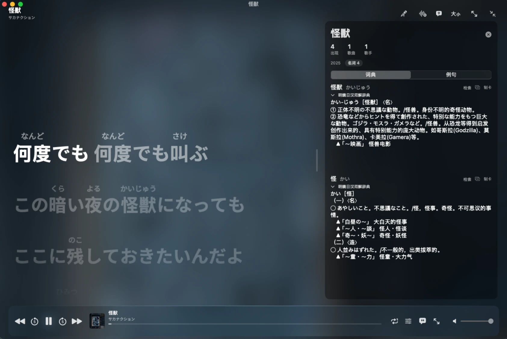
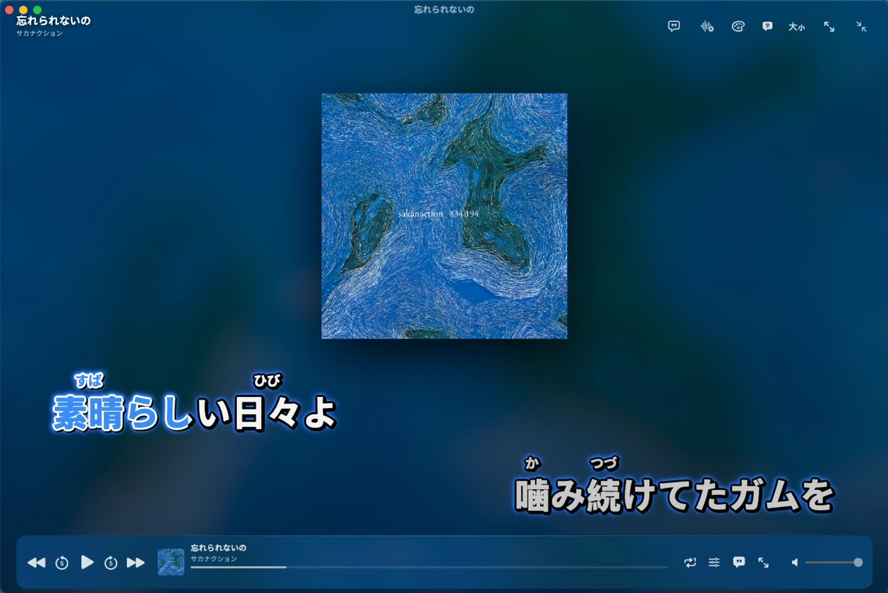
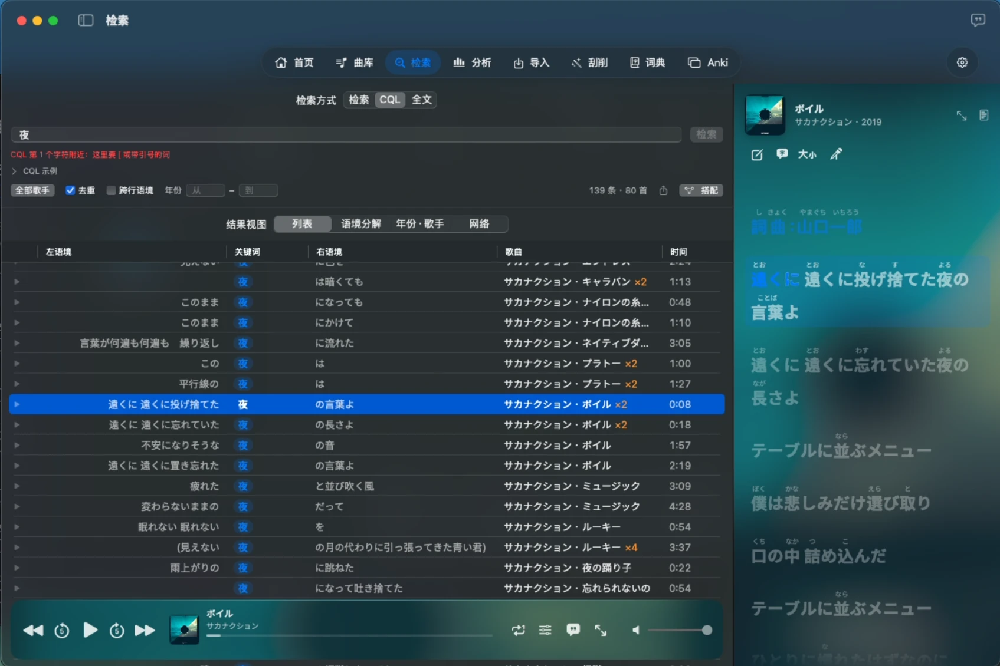

<div align="center">

# JPOP Corpus Tool

[](LICENSE)
[](https://github.com/Yisoragoto/jpop-corpus-tool/releases)
[](#development)

A local music corpus. Import songs and lyrics you own, follow the lyrics word by word as the
audio plays, look words up Yomitan-style, search a word across your whole library and hear the line it is sung
in, run corpus analyses — frequency, collocations, sub-corpus comparison — and turn the lines you just heard into
Anki cards.

[简体中文](README.md) · **English**

[Download](#download) · [Features](#features) · [First run](#first-run) · [Development](#development) · [Methods](#methods-corpus-linguistics)

<table>
<tr>
<td colspan="2"></td>
</tr>
<tr>
<td colspan="2" align="center"><sub>Windows · click a word in full-screen lyrics and the side panel turns into the dictionary</sub></td>
</tr>
<tr>
<td width="50%"></td>
<td width="50%"></td>
</tr>
<tr>
<td align="center"><sub>Windows · Karaoke</sub></td>
<td align="center"><sub>Windows · Full-screen lyrics with credits</sub></td>
</tr>
<tr>
<td width="50%"></td>
<td width="50%"></td>
</tr>
<tr>
<td align="center"><sub>Windows · Artist profile</sub></td>
<td align="center"><sub>Windows · Word cloud</sub></td>
</tr>
</table>

<table>
<tr>
<td width="33%"></td>
<td width="33%"></td>
<td width="33%"></td>
</tr>
<tr>
<td align="center"><sub>macOS · Looking a word up in full-screen lyrics</sub></td>
<td align="center"><sub>macOS · Karaoke subtitle style</sub></td>
<td align="center"><sub>macOS · CQL search with lyrics following playback</sub></td>
</tr>
</table>

</div>

> This repository ships source code and build tooling only. It contains no commercial songs, lyrics,
> third-party dictionaries, Anki decks or pre-built corpus database.

## Download

Get the latest release from [Releases](https://github.com/Yisoragoto/jpop-corpus-tool/releases):

| System | File | Notes |
|---|---|---|
| Windows 10/11 | `JPOP.Corpus.Tool_x.y.z_x64-setup.exe` (recommended) or the `.msi` | Needs the WebView2 runtime, which Windows usually has; the installer offers it if not |
| macOS 14+ (Apple Silicon) | `JPOP.Corpus.Tool_x.y.z_macOS_arm64.dmg` | Open it and drag `JPOP Corpus` into Applications |

**Opening it on macOS the first time**: the app is not signed or notarized by Apple, so the first launch is blocked.
Go to **System Settings → Privacy & Security**, find the app near the bottom and click **Open Anyway**; or run this
once in Terminal:

```bash
xattr -dr com.apple.quarantine "/Applications/JPOP Corpus.app"
```

Both clients share one Rust core and one library format: a library folder copied from Windows opens on a Mac as
is, and the other way round.

The interface comes in **English and Simplified Chinese**: pick one on first launch and switch any time in Settings.

**Updates**: when a new release is out, a dialog shows what changed and lets you choose **Update now**, **Later**
or **Skip this version**. On Windows the installer is pulled from this repository's Releases, its SHA-256 is
verified, and it installs over the current version (no uninstall step) and reopens the app. You follow stable
releases by default; to try changes early, switch to the debug channel in Settings, which follows every push to
main on both Windows and macOS. The macOS app tells you about a new version; download the new `.dmg` from Releases and install over the old one.

The old PyQt6 Python code is kept under `legacy/` for reference; `corpus.db` works with it too.

## Features

### Home

Pick up where you left off: **Continue listening** stops at the line you were on; today's listening, songs
finished and cards made; how many distinct words the songs you have heard contain; recently added songs. The
search box at the top searches titles, artists, albums, lyrics and words across the library.

### Library: musicians, albums, songs

- Browse four ways: **musicians, behind the scenes, albums, songs**. Band members are nested under their band,
  former members with their years; a member who went solo gets their own profile, with solo work kept apart from
  the band years.
- **Artist profiles** look like an artist page in a music app: a large photo, roles and active years, one button to
  play everything and one to open this artist's word cloud.
  - Overview: every song by this artist, newest first, one click to play (as a list or as large covers); albums and
    EPs below; members and frequent co-credits on the right.
  - Works (track lists by album), members & collaborators, and a timeline.
  - Artist photos can be replaced by hand; scraping won't overwrite them, and the scraped one can be restored.
- Memberships come from scraping (MusicBrainz), from credit-based suggestions you confirm, or from manual edits;
  whatever you change or reject is never overwritten by a scrape.
- Songs have a breadcrumb (artist › album › title) and clickable credits; edit, replace lyrics, line-by-line lyric
  editing, source & validation, and delete live in the "⋯" menu.
- The **relationship graph** follows Obsidian's graph view: everyone and their collaborations as one network. Colour
  is the role, node size follows how many songs they are on; solid lines are shared credits, dashed lines are band
  membership. Drag, zoom, filter by role and by "at least N songs together", double-click to open a profile.
- The **timeline** lays out every album and single by release date, with covers and track lists, vertical or
  horizontal; where a band split, it leads on to the members' solo lanes.

<p align="center"></p>

### Playback and lyrics

- **Word-timed lyrics**: songs with word timing light up character by character as they are sung, as in any music
  app; songs with line timing only highlight whole lines — word timing is never faked by spreading a line evenly.
- **Full-screen lyrics**: the cover blurred behind, cover art and vocals / lyrics / music / arrangement credits on
  the right; click a word in the lyrics and the side panel turns into the lookup. Furigana over kanji only or over
  whole words; main and fallback font, size, furigana size, line height and letter spacing are adjustable, and you
  can import your own font files.
- **Karaoke**: two lines alternating top and bottom KTV-style, title and credits during the intro, a countdown
  before the first line after a long break.
- **Timing editor**: time a song yourself where it has no word timing — hold Space while a character is sung, or tap
  once per character; a waveform below shows one block per character whose edges you drag, with ±10 ms / ±100 ms
  nudges, undo/redo and slowed playback. It saves as a new lyrics version that batch fetching won't overwrite.
- Click a line to jump there, or loop one line. Where a line starts and ends follows one rule everywhere, so looping
  the line before a break doesn't loop the break.
- A player bar modelled on Apple Music: ±5 s skips, speed and key in one panel. Speed changes keep the pitch
  (WSOLA); key changes are rendered once per song by the built-in Rubber Band library and cached.
- F11 puts the whole app in full screen; layouts are tuned for narrow windows and for 27-inch and larger screens.

### Where word-timed lyrics come from

On import, an `.lrc` next to the audio and lyrics embedded in the file are picked up (word timestamps in enhanced
LRC are kept). For songs with no lyrics, or with line timing only:

- **Fill in word-timed lyrics** on the Scrape page does the whole library; on import, "fetch lyrics afterwards,
  word-timed first" is ticked by default.
- For a single song, **Search word-timed lyrics** shows each candidate's source, format, number of lines with real
  word timing and a text preview before you adopt it.
- Sources: QQ Music (QRC), Kugou (KRC), the AMLL community word-timed lyrics database (TTML), LRCLIB and NetEase;
  each can be switched off. QQ Music and Kugou have no public lyrics API, so their client endpoints are used; they
  may stop working at any time. Lyrics are read locally for personal study and are never cached or redistributed.
- **No guessing**: title, artist and duration have to match and the text has to agree at least 97 % with the lyrics
  you already have before anything is adopted automatically; uncertain matches go to a review list. Lyrics you
  imported, edited or timed by hand are never overwritten by a batch run.
- Import a lyrics file yourself: `.lrc` / `.txt` / `.yrc` / `.qrc` / `.krc` / `.ttml`, in UTF-8, Shift-JIS or GBK.

Details: [docs/word-lyrics.md](docs/word-lyrics.md) and [docs/karaoke.md](docs/karaoke.md) (Chinese).

### Word lookup (Yomitan dictionaries)

[Yomitan](https://github.com/yomidevs/yomitan) is the browser pop-up dictionary for Japanese (the successor to
Yomichan). It defines a dictionary package format: one zip holding terms, reading-aware frequencies, pitch accent
and structured glossaries. **Lookup here is a port of what Yomitan does, to Rust**, so it uses those dictionaries
directly:

- Import Yomitan zips on the Dictionaries page, as many as you like, grouped by kind (glossary / frequency / pitch)
  and dragged into the order results follow.
- Inflected forms, katakana and romaji all resolve; matching runs from the clicked word to the end of the line, so
  clicking the first word of 打ち込んでいませんでした gets you back to 打ち込む.
- Glossaries are shown in the dictionary's own styling (nesting, examples, images); pitch and frequency per reading.
- Click a word in the lyrics and you first see how often it occurs in your corpus, in how many songs, by how many
  artists and in which years; below, **Dictionary** and **Examples** tabs: the glossary, and every line in your
  corpus with that word, each with ▶ to hear it.

**Dictionaries are not included.** [MarvNC/yomitan-dictionaries](https://github.com/MarvNC/yomitan-dictionaries)
collects download links for the usual ones (JMdict, 三省堂, 明鏡, JPDB frequency, pitch-accent dictionaries…).
Each dictionary's licence and redistribution terms are its author's; check them yourself.

<p align="center"></p>

### Search: from a word to the line it is sung in

- KWIC concordance with the keyword centred. Match by written form or by dictionary form (駆ける / 駆けた / 駆けろ
  together); filter by artist, year, part of speech, cross-line matches or Japanese-only, or restrict it to a
  sub-corpus; export CSV.
- Multi-word expressions are written with `+` (`て+しまう`); a "near" filter keeps only lines where another word
  occurs within a few words.
- Identical lines within one song (choruses) are folded into one hit by default, with the repeat count shown.
- **Search results are wired to the player**: ▶ plays just that line (stops at the line end), ⟲ adds one line of
  context on each side, and clicking a hit opens the song at that line and keeps playing with the lyrics highlighted.
- A collocation panel lists words within 3 words of the keyword; pick one to narrow the concordance to lines where
  it occurs nearby.

<p align="center"></p>

### Word cloud

- Scope it to the whole library, one artist or a sub-corpus, and to a range of years.
- Different spellings of one word are merged (想い出 → 思い出, ひとり → 一人), only when the readings match too.
- Particles, auxiliaries, single kana such as つ, ら and nominal forms such as まま are left out by default; hide any
  word with **Don't show in the word cloud** and restore it later.
- Optional colouring by part of speech.
- Click a word to list the songs it appears in, **songs where it starts a line first**; click a song and it **plays
  from that word itself** — exact where there is word timing, otherwise you can calibrate it once by tapping as you
  hear the word, and it is remembered.
- The same song list opens beside the **Analytics** tables and the **Dictionary**: click any word there and play it
  from the word without leaving the page. In **KWIC**, a click plays from the matched word and keeps you on the page
  (double-click opens the song in the Library). While something plays, every page shows the line being sung at the
  bottom with the word highlighted; full-screen lyrics opened from there return you to where you were.
- Full-screen mode and PNG export.

### Analysis: choruses don't inflate the numbers, and results say where they came from

J-pop repeats its choruses: in a real library, repeated lines make up about 23 % of lines and 20 % of tokens.
Counted naively, a good part of a frequency list is chorus. So every statistic on the Analytics page can count
**every token**, or count **each repeated line within a song once**.

- **Frequency**: lemma × part of speech with JLPT level; both counts side by side, plus the share coming from
  repeated lines and dispersion (DP, ARF).
- **KWIC sorting and plot**: sort by the nth word left or right of the keyword; the plot draws one bar per song,
  showing whether a word is spread through a song or packed into its chorus.
- **Collocations**: logDice, MI, MI3, t-score, z-score, log-likelihood and ΔP in both directions.
- **CQL search**: find word sequences by token attributes, e.g. `[lemma="君"] [pos="ADP"]`,
  `[pos="VERB" & cform="命令形.*"]`, `[lemma="て"] []{0,2} [lemma="しまう"]`, with live syntax checking.
- **Breakdown by year or artist**: how often a search hits per 10,000 tokens in each year or each performer's songs,
  with small groups flagged.
- **Collocation network**: the keyword, its 20 strongest collocates, and how those collocates co-occur with each other.
- **N-grams**: fixed sequences of 2–5 words that never cross a line break or punctuation, with a minimum number of songs.
- **Conjugation and spelling**: conjugation forms (click a word to search it in that form) and spelling variants of the
  same word (君 / きみ / キミ); concordance search can match by reading or normalized form.
- **Chorus effect**: the same songs counted both ways, showing which words were pushed up the list by choruses.
- **Sub-corpus comparison**: pick two sets of songs (one artist against the rest, the 2010s against the 2020s…) and
  find the words one side uses markedly more or less, by signed log-likelihood and Log Ratio; filter by p-value,
  optionally Bonferroni-corrected.
- **Lexical richness and scripts**: MATTR, MTLD and Yule's K for the whole selection, each performer or each song,
  with the share of kanji, hiragana, katakana and Latin letters.
- **Song profile**: how much of a song is repeated, and its characteristic words compared with the other songs.
- Frequency table, a timeline by year, TTR / standardised TTR, and a corpus report as TXT.

**Sub-corpora**: slice by artist, year, album, genre, lyric language, chosen songs and minimum lyric completeness —
conditions are ANDed, multiple values within one are ORed. Save them under a name and use them directly in KWIC,
the word cloud, examples, frequency, collocations and comparisons.

**Every result carries its provenance**: scope, counting unit, rule version and a fingerprint of the library at the
time. Same fingerprint and parameters, same result.

**Reproducible analyses**: archiving an analysis stores the filter, every song in scope with its lyric version, the
tokenizer, the counting rules, and the app and schema versions. Re-run it later on the current library and compare
item by item, with an explanation of why the result changed — the library changed or the counting rules did.

The statistics used, and where they come from, are described under [Methods: corpus linguistics](#methods-corpus-linguistics).

<p align="center"></p>

### Corpus quality and provenance

- **Every set of lyrics is kept as a version**: its source (file / embedded / online / manual / timed by hand),
  import time, the original text verbatim and a content fingerprint. Replacing lyrics adds a version; old ones can
  be viewed and restored.
- **Automatic validation**: missing or truncated lines, pasted duplicates, timestamps going backwards or past the end
  of the song, long gaps, mojibake, leftover timestamps and credits, lyrics not in Japanese; plus an estimated
  completeness.
- **Line-by-line lyric editing**: fix text, add or remove lines, move timestamps; saved as a new version,
  re-tokenised, with your token corrections re-applied by text.
- **Revision history**: replaced lyrics, hand timing, token corrections and reverts, re-tokenisation, metadata edits
  and deletions are all recorded.
- **Field provenance**: whether each field came from tags, the file name, the folder, scraping (which source, what
  match score) or your own edit; manual edits are never overwritten by automatic steps.
- **Content identity**: ISRC, MusicBrainz IDs, label, and an audio fingerprint that survives renaming the file.

Design notes: [docs/provenance.md](docs/provenance.md) and [docs/content-identity.md](docs/content-identity.md) (Chinese).

### Anki mining

[Anki](https://apps.ankiweb.net/) is the open-source spaced-repetition app;
[AnkiConnect](https://ankiweb.net/shared/info/2055492159) is the add-on that opens a local port for other programs
to add cards through. That is how cards get made here — **local only, nothing is uploaded**.

- Press **＋ Mine** on a lookup result: word, glossary, frequency, pitch and a real example go into Anki together.
- Ships a **Lyrics** note type adapted from [Lapis](https://github.com/donkuri/lapis): cover art on the right of the
  back side with title, artist and album. Created on first use if Anki doesn't have it.
- The example is the line you clicked, followed by the other lines in that song containing the word — **each with its
  own audio clip cut from the song**.
- Optional per-artist subdecks; reads Anki's learning state so words you already know can be left out.
- The Anki page selects, previews and exports words in bulk; a mining report (HTML) lists, by JLPT level, the words
  in your corpus that have no card yet.

<p align="center"></p>

### Importing, scraping and library maintenance

- Import a folder **or individual songs**; scanning is read-only, nothing is written until you have reviewed the
  plan; **the original metadata in your files is never overwritten**. The plan marks each file as new, already in
  the library, a possible duplicate or unimportable.
- Drop new audio into a folder your library already uses and the next start offers to import the new songs.
- The Scrape page is a library-completeness checklist: identification, track covers, album covers, album details
  (release type, track count), artist photos, lyrics and durations each get a row showing what is missing and a
  button to fill exactly that; **Fill in word-timed lyrics** lives here too.
  - Tracks are identified through iTunes → MusicBrainz (optionally the Apple Music catalogue), covers come from
    Cover Art Archive, artist photos from Deezer. Anything below the confidence threshold waits in a review queue.
  - Scraping an artist also picks up band members, the date a band split and full release dates.
- Already have a library elsewhere? **Settings → Library maintenance → Migrate from another library directory**
  previews what would move, then **merges** it into the current library.
- **Export diagnostics** in Settings bundles the version, library location and size, dictionary and audio status,
  and recent errors in one go, for attaching to a bug report.

### Native macOS client

`macos/` is a native SwiftUI client (AVFoundation playback with real-time speed and key changes) with **no business
logic of its own**: search, analysis, import, tokenisation, lookup, mining, scraping, lyric timing, the schema and
its migrations all come from the same Rust core (through `jp-ffi`: one entry point, JSON in and out, method names
matching the Windows app's commands).

Everything listed above is on the Mac too: home, the library (graph, timeline, word cloud), full-screen lyrics,
karaoke and the timing editor, word-timed lyric fetching, search and auditioning, analysis and archives,
dictionaries, Anki mining and the Anki page, scraping, import and update checks. The per-feature status and test
coverage are in the [macOS capability matrix](docs/macos-status.md) (Chinese).

- Open a library copied from Windows: when it stores paths like `E:\...`, audio is found by file name in folders you
  point it at.
- Or start a new one in `~/Library/Application Support/JPOP Corpus Tool`.

### Command line

`jp` is a batch front end to the same library: library info, scan, import, tokenise, scrape, Anki TSV export and
audio fingerprints. Build it from source (`cargo run -p jp-cli -- <command>`); see [docs/cli.md](docs/cli.md) (Chinese).

## First run

1. Open **Import** and pick a folder of audio you legally own, or choose individual files. An `.lrc` with the same
   name next to the audio is matched automatically.
2. Review the scan plan, then import.
3. For songs without lyrics or with line timing only, use the **Scrape** page, or handle a single song from the library.
4. Covers, artist photos and band members are filled in on the **Scrape** page as well.
5. For lookup, import Yomitan zips on the **Dictionaries** page.
6. For mining, start Anki with AnkiConnect installed (see below).

### Data directory

`corpus.db`, `raw/audio`, `raw/lyrics_lrc`, `raw/covers` and `dictionaries.db` are looked up in this order:

1. the `JPOP_CORPUS_HOME` environment variable;
2. the directory picked in Settings (remembered in `%LOCALAPPDATA%\JPOP Corpus Tool\settings.json`);
3. walking up from the executable, the first database that **has its tables**;
4. the current working directory;
5. otherwise `%LOCALAPPDATA%\JPOP Corpus Tool`, **creating an empty library there**.

On macOS the default is `~/Library/Application Support/JPOP Corpus Tool`. The data directory lives outside the
install directory, so uninstalling never takes your songs and corpus with it. If you already have a library, point
**Change directory…** in Settings at it and restart.

The schema is versioned: an older library is brought up to date on open (tables and columns are only added,
existing data is untouched), and a library newer than the app is refused rather than damaged.

> **Furigana, clicking words in lyrics and tokenisation on import need the Sudachi dictionary.** It is not in the
> installer (207 MB unpacked). A banner offers it when it's missing, and Settings has a Download button — a 43 MB
> `.xz` from this repository's `sudachi-dict-core` release (interrupted downloads resume), checked against a fixed
> SHA-256 and unpacked into `sudachi/` in the library directory. It can also be copied from a folder you already
> have. Once it's installed, songs imported without tokenisation are tokenised on the spot.
>
> Without it, playback, the Dictionaries page, search and mining still work; newly imported songs just aren't
> tokenised, so search and analysis can't see them.

### Anki

1. Install and start [Anki](https://apps.ankiweb.net/).
2. Install [AnkiConnect (add-on code 2055492159)](https://ankiweb.net/shared/info/2055492159).
3. Choose a deck and note type under Mining in Settings (the bundled **Lyrics** type is the default and is created on first use).

AnkiConnect listens on `http://127.0.0.1:8765` only, and this tool sends your corpus or Anki data nowhere.
Mining **only appends**: a word you already made a card for is skipped, never overwritten.

## Development

### Prerequisites

- [Node.js](https://nodejs.org/) 20+
- [Rust](https://rustup.rs/) stable, with the MSVC C++ build tools (SQLite, LAME and Rubber Band are compiled from source)
- Windows 10/11 with the WebView2 runtime
- For the macOS client: macOS 14+ and Xcode 15.3+ (Swift 5.10)

### Windows client

```powershell
git clone https://github.com/Yisoragoto/jpop-corpus-tool.git
cd jpop-corpus-tool\app
npm install
npm run app:dev      # development mode
npm run app:build    # installers land in rust/target/release/bundle/
```

### macOS client

```bash
./macos/scripts/build-rust.sh      # build the Rust core as libjp_ffi.a (pass "universal" for a fat binary)
cd macos && swift run JPCorpus      # run it; ./scripts/bundle.sh makes a .app
swift test                          # calls Rust through the real static library: data shapes, import and search end to end
```

### Checks

```powershell
cd app
npm run typecheck
npm test
cd ..\rust
cargo test --workspace
cargo clippy --workspace --all-targets
```

`examples/` shows the data formats without any copyrighted content.

CI runs three workflows: `check.yml` (frontend typecheck and tests, Rust tests and clippy); `macos.yml` on a macOS
runner (Rust static library, `swift build`, `swift test`, and a real run of the .app with screenshots); and
`release.yml`, which publishes a debug pre-release on every push to main and, when run by hand with stable, a release
with the Windows installers and the macOS `.dmg`.

### Project layout

```text
app/           Windows client frontend (React 19 + TypeScript strict + Vite)
macos/         Native macOS client (SwiftUI + AVFoundation) on the same Rust core
rust/          Rust workspace
  jp-app/        Tauri shell: commands, state, path permissions
  jp-ffi/        C ABI (JSON in/out) for the macOS client
  jp-cli/        The jp command line
  jp-corpus/     Data layer, all SQL lives here; search, analysis, sub-corpora, line spans, word timing, provenance, migrations
  jp-library/    Library management shared by both clients: transactions, file maintenance, migration
  jp-lyrics/     Lyric editing, versions, timing and online fetching
  jp-tokenizer/  Tokenisation and UPOS mapping (Sudachi)
  jp-setup/      Locating, downloading, verifying and resuming the tokenizer dictionary
  jp-audio/      Playback: WSOLA stretching, key change, spectrum, single-line loop, waveform
  jp-dict/       Yomitan-style lookup and dictionary import
  jp-anki/       Card mining and the mining report
  jp-scraper/    Track identification, covers, artist photos, band members, online lyrics
  jp-scrape/     Writes scraping results into the library (shared by both clients)
  jp-import/     Scan, plan, write
  jp-normalize/  Title / artist normalisation
  jp-fonts/      Lyric fonts: system fonts and imported font files
  jp-update/     Update checks, download verification
  jp-diagnostics/ Diagnostics export
docs/          Design notes and reconciliation records per subsystem
legacy/        The 0.1.x PyQt app, kept for reference
scripts/       Release guard and self-check scripts
assets/fonts/  Bundled OFL fonts and their licences
examples/      Data-format samples with no copyrighted content
```

`docs/` (in Chinese) records how each subsystem works, why it was done that way, and which numbers were reconciled
against the old version during the port:

| Doc | About |
|---|---|
| [clients.md](docs/clients.md) | One Rust core, two clients; how data maps to audio; counting rules for analysis |
| [macos-status.md](docs/macos-status.md) · [macos-player.md](docs/macos-player.md) | macOS capability matrix and validation; the macOS player |
| [word-lyrics.md](docs/word-lyrics.md) · [karaoke.md](docs/karaoke.md) | Word-timed lyric sources and validation; karaoke and the timing editor |
| [provenance.md](docs/provenance.md) · [content-identity.md](docs/content-identity.md) | Lyric versions, validation, revision history, field provenance, reproducible analyses; ISRC, MBID and audio fingerprints |
| [import.md](docs/import.md) | Scan, plan, write; lyric matching |
| [tokenizer.md](docs/tokenizer.md) · [token-corrections.md](docs/token-corrections.md) | Tokenisation, POS mapping, token corrections |
| [dictionary.md](docs/dictionary.md) | The Yomitan lookup port and its reconciliation |
| [anki.md](docs/anki.md) | Mining, the Lyrics note type, the mining report |
| [scraper.md](docs/scraper.md) · [scraper-rust.md](docs/scraper-rust.md) | Scraping sources, matching and confidence |
| [updates.md](docs/updates.md) | Stable / debug release channels and update verification |
| [cli.md](docs/cli.md) | The command line |
| [testing.md](docs/testing.md) · [BUGS.md](docs/BUGS.md) | Tests and smoke runs; bug reproductions, root causes and regression tests |
| [rust-core.md](docs/rust-core.md) · [tauri-shell.md](docs/tauri-shell.md) | What each Rust crate does; the Tauri shell |

## Methods: corpus linguistics

This tool is a small specialised corpus: the texts are your own songs, the unit is a timestamped lyric line, and the
analyses follow standard practice in corpus linguistics. What follows is how the program actually computes things.

**Corpus and annotation.** Each song's lyrics are stored line by line and tokenised with Sudachi (split mode C);
UniDic parts of speech are mapped to [Universal Dependencies UPOS](https://universaldependencies.org/u/pos/), and
the lemma is Sudachi's dictionary form. Each token also keeps Japanese morphology: detailed part of speech,
conjugation type and form, reading and normalized form (キミ → 君, 逢う → 会う); after an upgrade, existing tokens are
annotated in the background by aligning to the original text, without changing their segmentation or POS.
Tokenisation you correct by hand is stored separately and re-applied by text after re-tokenisation.

**CQL search.** The syntax is a subset of the Corpus Query Language used by Sketch Engine and CQP: square brackets
hold the conditions for one token (`word` `lemma` `pos` `tag` `ctype` `cform` `reading` `norm`; values are regular
expressions matched in full, combined with `&` `|` `!`), `[]` is any token, and `?` `*` `+` `{m,n}` repeat it.
Matches never cross a line, punctuation counts as a token, and the longest match is taken at each start without overlap.

**Breakdown and collocation network.** Search hits can be grouped by year or performer and normalised per 10,000
tokens (hits and denominators both count every token, punctuation excluded from the denominator), with the ratio to
the overall rate; groups under 1,000 tokens are flagged as small samples. The collocation network takes the top 20
collocates of the node and counts how often they co-occur with each other in the same window, keeping each word's
three strongest links by logDice.

**Conjugation and spelling.** Inflecting words are counted by conjugation form (imperative, volitional…), and
concordance search can filter by form. Spellings of the same word (君 / きみ / キミ) are grouped by normalized form;
all-kana spellings join the kanji spelling with the same reading and part of speech, and potential verbs (行ける) are
kept apart from their base verbs (行く) by conjugation type. Search can also match by reading or normalized form.

**Concordancing.** The KWIC (Key Word in Context) line is the basic form of corpus retrieval (Sinclair 1991): the
keyword centred, its context to either side. Matching is by written form or by lemma, with multi-word sequences and
a co-occurrence ("near") filter; lines can be sorted by the *n*th word left or right of the keyword, or drawn as a
plot (one bar per song, a tick where each hit falls).

**Counting unit.** What sets lyrics apart from written corpora is repetition: a chorus is sung several times
verbatim. Lines with identical text within one song form a repeat group, and every statistic can count every token
or each group once, reporting the difference (the share coming from repeated lines). This is de-duplication at the
song level, and it tells you whether a word is frequent because many songs use it or because a few choruses repeat it.

**Frequency and dispersion.** Raw and per-10,000-token frequencies of lemma × part of speech. Frequency alone cannot
tell "used in many songs" from "repeated in a few", so dispersion is given with each song as a corpus part, weighted
by song length:

| Measure | Definition | Source |
|---|---|---|
| DP | ½ Σ \|vᵢ/f − sᵢ\|, 0 = even, 1 = concentrated; DPnorm divides by 1 − min sᵢ | Gries 2008; Lijffijt & Gries 2012 |
| Juilland's D | 1 − CV / √(n − 1), CV of the songs' relative frequencies | Juilland & Chang-Rodríguez 1964 |
| ARF | the token stream as a circle; gaps between occurrences longer than N/f are capped | Savický & Hlaváčová 2002 |

**N-grams.** Sequences of *n* consecutive words (lexical bundles, Biber et al.) that never cross a line break or
punctuation, with an optional minimum number of songs to leave out sequences repeated only in one chorus.

**Lexical richness.** TTR (types ÷ tokens) and standardised TTR (the mean over fixed-length segments, as in Scott's
WordSmith) fall as a text grows, so texts of different size cannot be compared with them. Three measures that depend
much less on length are added: MATTR (window 50, Covington & McFall 2010), MTLD (threshold 0.72, mean of a forward
and a backward pass, McCarthy & Jarvis 2010) and Yule's K. Scripts are counted by character: kanji, hiragana,
katakana, Latin letters and other.

**Collocation.** Co-occurrences are counted within *n* words either side of the node, with expected frequencies
based on the actual number of window positions:

| Measure | Formula | Source |
|---|---|---|
| MI | log₂(O / E) | Church & Hanks 1990 |
| t-score | (O − E) / √O | Church et al. 1991 |
| logDice | 14 + log₂(2·O / (f₁ + f₂)) | Rychlý 2008 |
| Log-likelihood G² | 2×2 contingency table | Dunning 1993 |
| MI3 | log₂(O³ / E) | Daille 1994 |
| z-score | (O − E) / √E | Berry-Rogghe 1973 |
| ΔP | P(collocate \| node window) − P(collocate \| elsewhere), both directions | Gries 2013 |

MI favours rare words and the t-score frequent ones; logDice does not depend on corpus size, which makes it suitable
for comparing sub-corpora. ΔP is directional and separates "A predicts B" from "B predicts A".

**Keywords and sub-corpus comparison.** Two sets of songs are compared word by word: log-likelihood G² (the two-cell
calculation of Rayson & Garside 2000) says whether a difference is significant, signed by its direction; Log Ratio
(Hardie 2014: the log₂ of the ratio of relative frequencies, zero counts smoothed to 0.5) says how large it is.
Significance and effect size are kept apart, so a tiny difference in a large corpus is not taken for a keyword.
p-values come from the chi-squared distribution with one degree of freedom, with an optional threshold and Bonferroni
correction (thousands of words are tested at once); BIC (Wilson 2013) and %DIFF (Gabrielatos & Marchi 2012) are
given as well.

**Reproducibility.** A corpus changes — songs are added, lyrics replaced, tokens corrected — so every analysis
records the library fingerprint, rule version and parameters; an archived analysis can be re-run as it was, compared
item by item, with the differences attributed to the data or to the rules.

References:

- Berry-Rogghe, G. L. M. (1973). The computation of collocations and their relevance in lexical studies. In A. J. Aitken et al. (Eds.), *The Computer and Literary Studies* (pp. 103–112). Edinburgh University Press.
- Biber, D., Johansson, S., Leech, G., Conrad, S., & Finegan, E. (1999). *Longman Grammar of Spoken and Written English*. Longman.
- Church, K. W., & Hanks, P. (1990). Word association norms, mutual information, and lexicography. *Computational Linguistics*, 16(1), 22–29.
- Church, K. W., Gale, W., Hanks, P., & Hindle, D. (1991). Using statistics in lexical analysis. In U. Zernik (Ed.), *Lexical Acquisition* (pp. 115–164). Erlbaum.
- Covington, M. A., & McFall, J. D. (2010). Cutting the Gordian knot: The moving-average type–token ratio (MATTR). *Journal of Quantitative Linguistics*, 17(2), 94–100.
- Daille, B. (1994). *Approche mixte pour l'extraction automatique de terminologie*. PhD thesis, Université Paris 7.
- Dunning, T. (1993). Accurate methods for the statistics of surprise and coincidence. *Computational Linguistics*, 19(1), 61–74.
- Gabrielatos, C., & Marchi, A. (2012). Keyness: Appropriate metrics and practical issues. CADS International Conference, University of Bologna.
- Gries, S. Th. (2008). Dispersions and adjusted frequencies in corpora. *International Journal of Corpus Linguistics*, 13(4), 403–437.
- Gries, S. Th. (2013). 50-something years of work on collocations. *International Journal of Corpus Linguistics*, 18(1), 137–165.
- Hardie, A. (2014). Log Ratio: An informal introduction. ESRC Centre for Corpus Approaches to Social Science (CASS).
- Juilland, A., & Chang-Rodríguez, E. (1964). *Frequency Dictionary of Spanish Words*. Mouton.
- Lijffijt, J., & Gries, S. Th. (2012). Correction to Stefan Th. Gries' "Dispersions and adjusted frequencies in corpora". *International Journal of Corpus Linguistics*, 17(1), 147–149.
- McCarthy, P. M., & Jarvis, S. (2010). MTLD, vocd-D, and HD-D: A validation study of sophisticated approaches to lexical diversity assessment. *Behavior Research Methods*, 42(2), 381–392.
- Rayson, P., & Garside, R. (2000). Comparing corpora using frequency profiling. In *Proceedings of the Workshop on Comparing Corpora* (pp. 1–6).
- Rychlý, P. (2008). A lexicographer-friendly association score. In *Proceedings of RASLAN 2008* (pp. 6–9).
- Savický, P., & Hlaváčová, J. (2002). Measures of word commonness. *Journal of Quantitative Linguistics*, 9(3), 215–231.
- Scott, M. WordSmith Tools help: Standardised type/token ratio.
- Sinclair, J. (1991). *Corpus, Concordance, Collocation*. Oxford University Press.
- Wilson, A. (2013). Embracing Bayes factors for key item analysis in corpus linguistics. In M. Bieswanger & A. Koll-Stobbe (Eds.), *New Approaches to the Study of Linguistic Variability* (pp. 3–11). Peter Lang.

## Libraries

| Name | Licence |
|---|---|
| [Tauri 2](https://tauri.app/) | Apache-2.0 / MIT |
| [React 19](https://react.dev/) | MIT |
| [rodio](https://github.com/RustAudio/rodio) · [rodio-wsola](https://crates.io/crates/rodio-wsola) | MIT / Apache-2.0 · Apache-2.0 |
| [Symphonia](https://github.com/pdeljanov/Symphonia) (decoding) | MPL-2.0 |
| [sudachi.rs](https://github.com/WorksApplications/sudachi.rs) | Apache-2.0 |
| [rusqlite](https://github.com/rusqlite/rusqlite) · SQLite | MIT · Public Domain |
| [lofty](https://github.com/Serial-ATA/lofty-rs) (audio tags) | MIT / Apache-2.0 |
| [ureq](https://github.com/algesten/ureq) | MIT / Apache-2.0 |
| [serde](https://serde.rs/) | MIT / Apache-2.0 |

## Attribution

| Name | What | Licence |
|---|---|---|
| [Yomitan](https://github.com/yomidevs/yomitan) | Dictionary lookup, deinflection, structured content, pitch display | GPL-3.0-or-later |
| [Lapis](https://github.com/donkuri/lapis) | Basis for the bundled **Lyrics** note type | GPL-3.0 |
| [hoshidicts](https://github.com/Manhhao/hoshidicts) | Dictionary storage design (no code copied) | GPL-3.0-or-later |
| [LDDC](https://github.com/chenmozhijin/LDDC) · [AMLL TTML DB](https://github.com/amll-dev/amll-ttml-db) | Reference for word-timed lyric formats and sources | GPL-3.0 · CC0-1.0 |
| [Klee One](https://fonts.google.com/specimen/Klee+One) · [LXGW WenKai](https://github.com/lxgw/LxgwWenKai) | Bundled fonts | SIL OFL 1.1 |
| [Fluent UI System Icons](https://github.com/microsoft/fluentui-system-icons) | Interface icons · [`third_party/fluent-ui-system-icons/COPYING`](third_party/fluent-ui-system-icons/COPYING) | MIT |
| [Rubber Band Library](https://breakfastquay.com/rubberband/) | Key changes. Source in [`third_party/rubberband/`](third_party/rubberband/), compiled into the app | GPL-2.0-or-later |
| [LAME](https://lame.sourceforge.io/) | MP3 encoding of the audio clips on Anki cards, compiled into the app | LGPL-2.0-or-later |

Per-file provenance is noted in the file headers; the full statement is in
[THIRD_PARTY_NOTICES.md](THIRD_PARTY_NOTICES.md).

## Copyright boundaries

Please do not commit or redistribute:

- commercial song audio, or lyrics and LRC files you have no right to;
- a `corpus.db`, processed corpus or Anki deck containing real lyrics;
- third-party Yomitan dictionaries without redistribution permission;
- local settings, caches, backups and user paths.

This tool processes material you provide and have the right to use. Copyright and fair-use rules differ by
jurisdiction; satisfy yourself about the ones that apply to you.

## License

Source code: [GNU General Public License v3.0 or later](LICENSE) (GPL-3.0-or-later).
Copyright (C) 2026 Yisoragoto and JPOP Corpus contributors.
