<div align="center">

# JPOP Corpus Tool

[](LICENSE)
[](https://github.com/Yisoragoto/jpop-corpus-tool/releases)
[](#从源码运行)

面向日语学习者的本地 J-pop 语料库。把自己拥有的歌曲和 LRC 歌词导入后，跟着音频逐行读歌词、
点词查释义（Yomitan 那一套），在整个曲库里检索一个词、听它在每首歌里被唱出来的那一句，
做词频、搭配、子语料对比这些语料分析，再把刚听到的真实例句做成 Anki 卡片。

**简体中文** · [English](README.en.md)

<table>
<tr>
<td>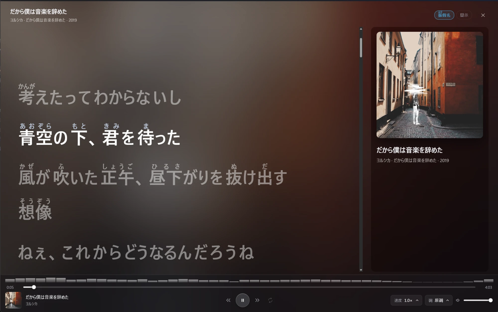</td>
<td>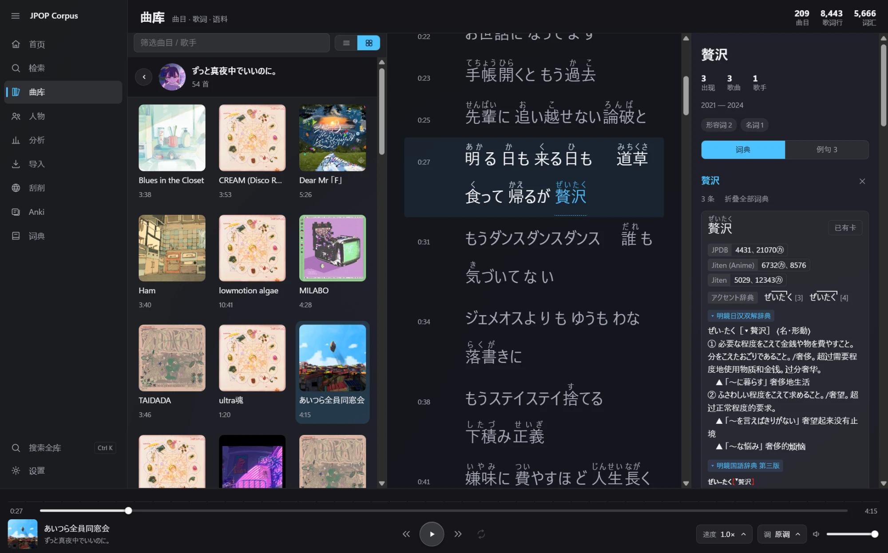</td>
</tr>
<tr>
<td>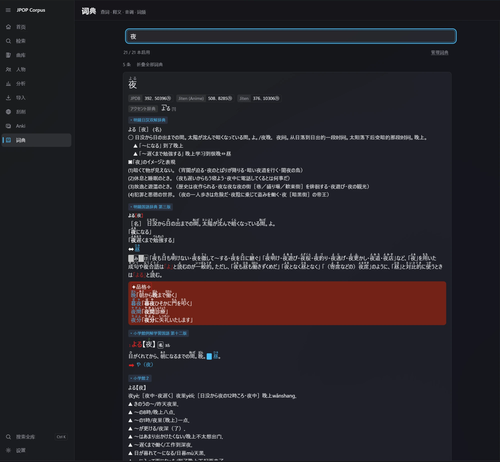</td>
<td>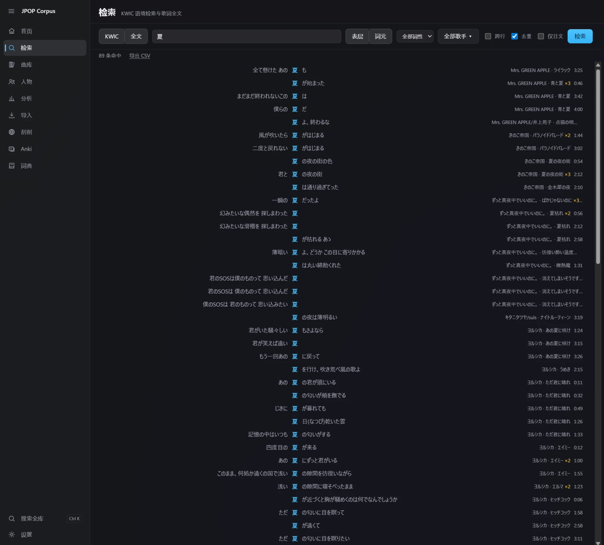</td>
</tr>
<tr>
<td>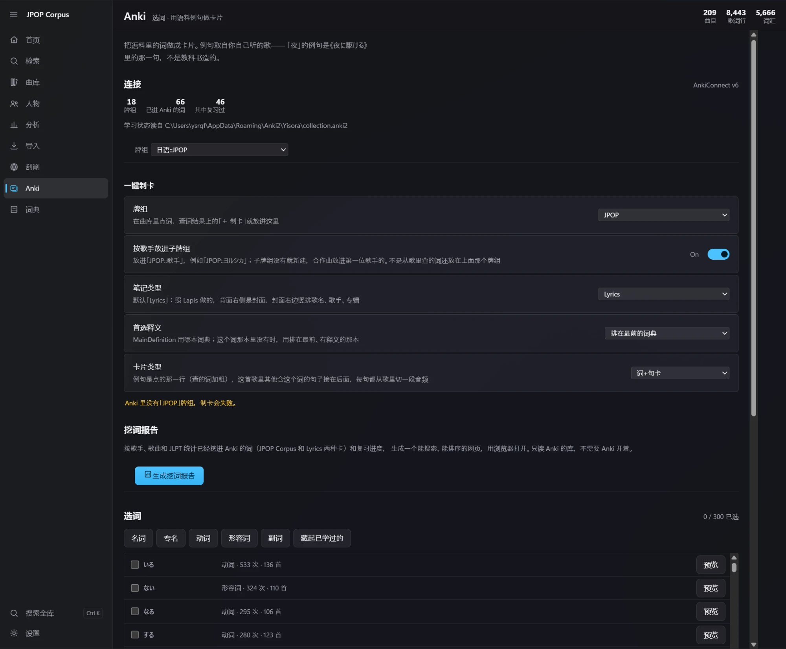</td>
<td>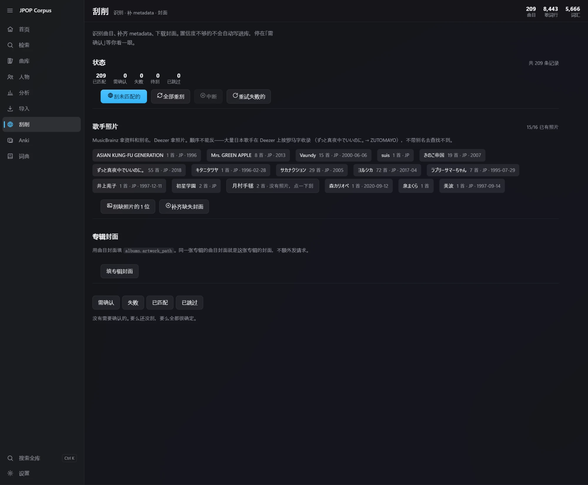</td>
</tr>
</table>

</div>

> 本仓库只提供程序源码和构建工具，不包含商业歌曲、歌词、第三方词典、Anki 牌组或预生成语料数据库。

## 下载

**Windows**：去 [Releases](https://github.com/Yisoragoto/jpop-corpus-tool/releases) 下载最新的
`JPOP.Corpus.Tool_x.y.z_x64-setup.exe`（或 `.msi`）。Windows 10/11 需要 **WebView2 运行时**，
系统一般已自带，安装程序也会按需引导安装。

「设置 → 系统」里可以检查更新、看更新日志，也可以直接下载安装新版本——安装包只从本仓库的
Releases 取，装之前校验 SHA-256。自动安装默认关着。

**macOS**：原生 SwiftUI 客户端（`macos/`），目前要从源码构建，见[原生 macOS 客户端](#原生-macos-客户端)。
两个客户端共用同一个 Rust 核心、同一种库，Windows 上的库目录整个拷到 Mac 上就能打开。

旧版（PyQt6）的 Python 代码留在仓库的 `legacy/` 下作参考，数据库 `corpus.db` 通用。

## 核心功能

### 资料库与播放

- 资料库把曲库和人物合在一页：按**音乐人、幕后、专辑、歌曲**四种方式找。
  - 乐队的成员收在乐队下面，前成员标出在队的年份；单飞的人另有自己的档案，个人作品和乐队时期的歌分开放（乐队的歌只属于乐队）。
  - 成员关系来自刮削（MusicBrainz）、按署名推测后由你确认、或者手动添加；你改过、否掉的，刮削不会覆盖。
  - 左栏可以收起，把整个宽度让给内容。
- 每个人一页档案：照片虚化铺底的档案头、做过哪些角色、所属乐队、发行时间轴、按专辑排的作品、合作者、资料来源。
  歌手照片可以自己换（刮削不会覆盖，随时能恢复成刮削的那张）。
- 歌：面包屑（演唱者 › 专辑 › 歌名）、署名都能点；编辑、换歌词、逐行编辑歌词、来源与校验、删除收在「⋯」里。

**关系网**照 Obsidian 的图谱：所有人和他们的合作连成一张网。节点颜色是角色（演唱、作曲、作词、编曲），
有照片的显示照片，圆圈的大小随参与的歌数变；实线是一起署过名，虚线是乐队和成员。能拖、能缩放，
悬停高亮邻居，按角色和「至少一起几首」过滤，选中一个人可以「只看附近」，双击打开档案。

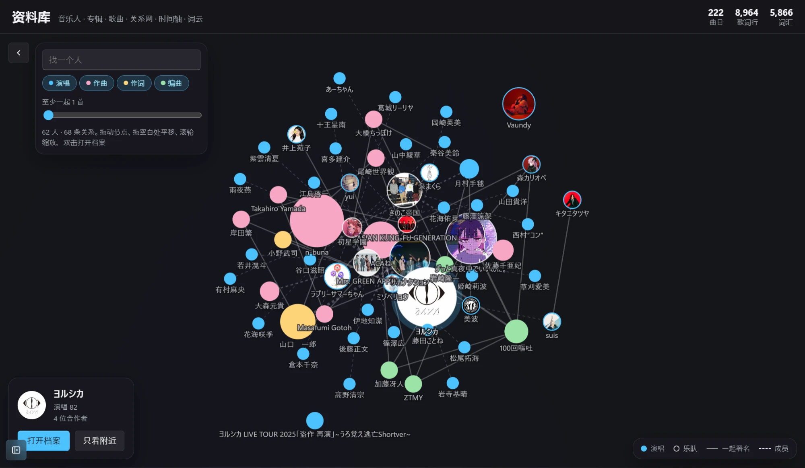

**时间轴**每位音乐人一行，发行按日期排开，节点就是专辑 / 单曲的封面；太密的地方自动错开或合成「+N」，
乐队解散处用虚线接到单飞的成员那一行。点名字放大成这个人的时间树，横排、竖排可选。

**词云**用毛玻璃卡片，底下铺着虚化的歌手照片。范围可以是整个库、一位歌手或一个子语料；
词性可选（默认名词）、可以只看日文、词数和字体都能换。点词在右边列出出现它的歌，点歌**就从那一句开始放并进全屏歌词**，
退出来还是词云；正在唱的那句当字幕显示在云下面。可以全屏、可以存 PNG。

<table>
<tr>
<td>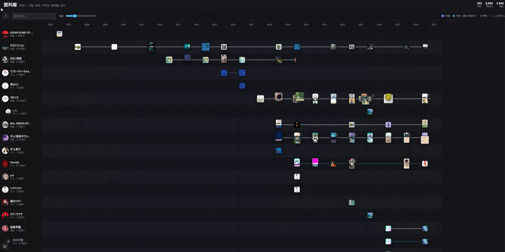</td>
<td>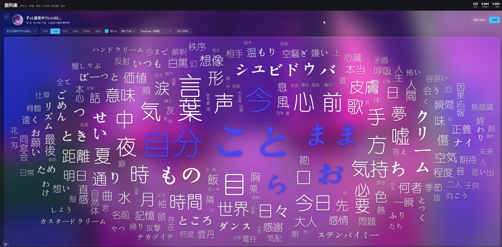</td>
</tr>
</table>

播放：

- 歌词跟随播放逐行高亮，点一行跳到那一句，可以对单句循环。一行从哪儿放到哪儿由同一套规则算
  （到下一行开始为止；碰到间奏按字数估），单句循环不会把间奏一起循环进去。
- 播放条照 Apple Music 的样子：毛玻璃、前后跳 5 秒、倍速和变调合在一个面板里、剩余时间 / 总长点一下切换。
- 倍速走 WSOLA 时间伸缩（**变速不变调**）；变调由内置的 Rubber Band 把整首歌渲染一次并缓存。
- 全屏歌词：背景是整张封面虚化铺满，右侧卡片列出演唱、作词、作曲、编曲，播放条是盖在上面的毛玻璃。
- 振假名支持「只注汉字」和「整词注音」，字体、字号、行距、字距都可调。
- 整个软件按 F11 全屏；窄窗口和 27 寸以上的大屏都做了适配。

### 查词（Yomitan 词典）

[Yomitan](https://github.com/yomidevs/yomitan) 是浏览器上的日语弹出式查词扩展（Yomichan 的继任者），
它定义了一套词典打包格式：一个 zip 里装着词条、按读音区分的词频、音高（アクセント）和结构化释义。
**本工具查词这一块是按 Yomitan 的做法移植到 Rust 的**，所以可以直接吃它那一套词典：

- 在「词典」页导入 Yomitan 格式的 zip，想装几本装几本，顺序可以拖着排——查词结果按这个顺序出。
- 活用形、片假名、罗马字都能查；从点的词一直到行尾做最长匹配，所以
  「打ち込んでいませんでした」点第一个词就能还原到「打ち込む」。
- 释义是结构化的（保留词典原本的层级、例句、图片），音高和词频都按读音分别显示。
- 资料库里点歌词上的词，右栏并列「词典」和「例句」两页：一页是释义，一页是这个词在你整个语料里出现过的句子，
  每句旁边点 ▶ 就能听那一句。

**词典本身要自己准备，仓库里不含任何词典。** 常用的几本（JMdict / 三省堂 / 明鏡 / JPDB 词频 / アクセント辞典 等）
可以在 [MarvNC/yomitan-dictionaries](https://github.com/MarvNC/yomitan-dictionaries) 找到下载地址。
各词典的版权和再分发条件由各自作者决定，自行确认。

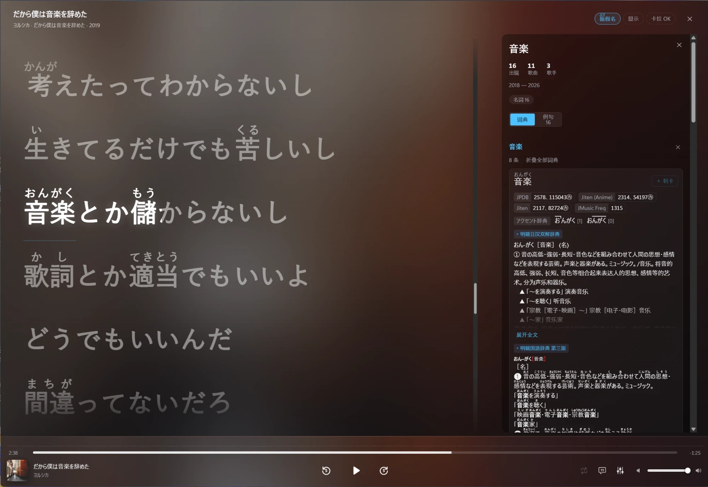

### 检索：从一个词到它被唱出来的那一句

- KWIC 语境检索：关键词居中对齐，可以按写法或辞书形（駆ける / 駆けた / 駆けろ 归到一起）匹配，
  按歌手、年份、词性、是否跨行、是否仅日文筛选，也可以限定在一个子语料里；结果可导出 CSV。
- 多词表达：`て+しまう` 这种连着出现的几个词当一个整体查；「附近有某词」只留下前后几个词以内出现它的行。
- 同一首歌里一模一样的行（副歌）默认合成一条，标出重复了几次。
- **检索结果直接连着播放器**：每条 ▶ 原地试听那一句（到行尾自动停），⟲ 连前后各一行一起听，
  单击跳到那首歌的那一行接着放、歌词跟着高亮；正在放的那条高亮。精度到行（时间戳来自 LRC，没有词级时间）。
- 搭配面板：关键词左右 3 词内的搭配词，点一个搭配词把 KWIC 收窄到「附近有它」的行。

### 分析：副歌不撑大数字，结果说得清从哪来

J-pop 的副歌会反复唱：真实语料里重复行占了约 23% 的行、20% 的词次。直接数的话，高频词表里有不少是副歌堆出来的。
所以分析页的每种统计都可以选两种口径——**全部词次**，或者**同一首歌里重复的行只算一次**。

- **词频**：词元 × 词性，带 JLPT 等级；两种口径的数都给，外加「来自重复行的比例」。
- **搭配**：logDice、MI、t 值、对数似然（2×2 列联表，期望值按实际窗口位置数算）。
- **副歌效应**：同一批歌两种口径各算一遍，看哪些词的排名是被副歌推上去的。
- **子语料对比**：圈两批歌（比如一位歌手和其余所有歌，或者 2010 年代和 2020 年代），用带符号的对数似然和 log ratio
  找出哪边明显多用、少用哪些词。
- **歌曲画像**：一首歌有多少行是重复的、相对其余歌的特征词（只留实词），在曲库右栏，点词去检索。
- 词频统计、按年份的时间线、语料报告 TXT 导出。

**子语料**：按演唱者、年份、专辑、流派、歌词语言、指定歌曲、歌词完整度下限切一块出来，条件之间是「且」、
同一条件里多选是「或」。条件可以起名存下，KWIC、词云、例句、词频、搭配、对比都能直接选它。

**每个结果都带出处**：范围、计数口径、规则版本，以及当时库的指纹（行数、词数、校正数、元数据的哈希）。
指纹和参数都一样，结果就一样；导入新歌、校正分词之后指纹会变，一眼看得出「这不是同一个库算的」。

**可复现的分析**：把一次分析存档时，连同筛选条件、纳入的每首歌和它的歌词版本、分词器（引擎、词典、切分模式、配置指纹）、
统计口径、程序和库结构的版本、生成时间一起存下。之后在现在的库上原样重跑，另存一条，逐项对比并说明结果为什么变了——
是库变了（换了歌词、校正了分词、加了歌），还是统计规则变了。

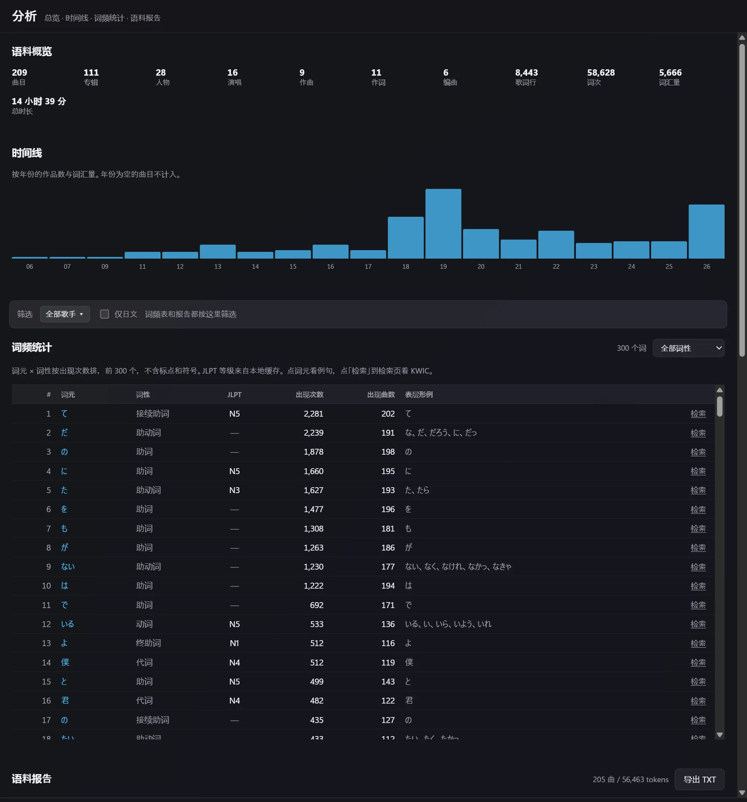

### 语料质量与来源追踪

语料是从各处拼起来的：歌词有的来自音频旁边的 `.lrc`，有的是在线补的，有的是自己贴的。为了知道每个数字背后是什么数据：

- **每份歌词都留一版**：来源（文件 / 内嵌 / 在线 / 手动）、导入时间、原文一字不改、内容指纹。
  换歌词是加一版，旧版能看原文、能恢复。
- **自动校验**：漏行、截断、重复贴行、时间倒退、超出歌长、长空档、乱码、残留的时间标记和署名、语言不是日文；
  给出完整度估计。每行歌词有时间戳置信度和分词状态（自动 / 已校正 / 待处理 / 空行）。
- **逐行编辑歌词**：改字、加删行、挪时间戳，存成新的一版，重新分词，并按原文把你的分词校正套回去。
- **修订历史**：换歌词、分词校正和撤销、重新分词、改曲目信息、删歌都留记录。
- **字段来源**：每个字段是从标签、文件名、目录、刮削（哪个来源、匹配分多少）还是你手改来的；手改的不会被自动流程覆盖。
  歌手资料也记来源和可信度。
- 分析页有一张「语料质量」卡片，汇总哪些歌的歌词可疑、缺什么。

设计说明见 [docs/provenance.md](docs/provenance.md)。

### Anki 制卡

[Anki](https://apps.ankiweb.net/) 是开源的间隔重复记忆软件，
[AnkiConnect](https://ankiweb.net/shared/info/2055492159) 是它的插件，开一个本机接口让别的程序往里加卡片——
本工具就是通过它制卡的，**只连本机，不上传任何东西**。

- 查词结果上点「＋ 制卡」，词、释义、词频、音高和真实例句一起进 Anki。
- 自带「Lyrics」笔记类型：照 [Lapis](https://github.com/donkuri/lapis) 改的，背面右侧是歌曲封面，
  封面旁边竖排歌名、歌手、专辑。Anki 里没有这个类型时第一次制卡会自动建。
- 例句是你点的那一行，这首歌里其他含这个词的句子接在后面，**每句都从歌里切一段对应的音频**。
- 可选按歌手放进「牌组::歌手」子牌组；能读 Anki 的学习状态，排除已经学过的词。
- 挖词报告（HTML）按 JLPT 分级列出语料里还没做成卡片的词。

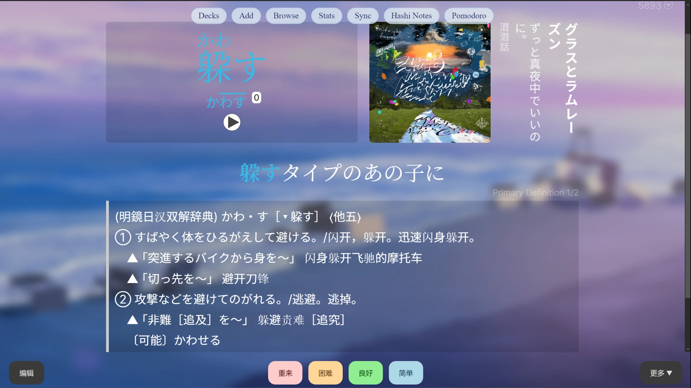

### 导入与元数据

- 导入：**选一个目录，或者直接选几首歌**；扫描只读取，复核计划之后才写库；
  **不覆盖本地文件里的原始 metadata**。计划里标出每个文件是新歌、已在库中、可能重复（不导，交给你看）还是导不了，
  以及歌手是从标签、文件名还是文件夹名定出来的。
- 往库里的歌所在的文件夹再放新音频，下次启动会提示「检测到 N 首新歌」，点一下就导进来
  （标签读不出的那种会先带你去看计划）。这一步只读、不会自己导入；看了哪些文件夹在「导入」页。
- 歌词：导入时自动认音频旁边的同名 `.lrc` 和音频里内嵌的歌词。没有的话——
  - 「设置 → 曲库维护 → 补齐缺失歌词」批量补：先看音频旁边有没有 `.lrc`，没有再上网搜（网易云）；
  - 资料库里单首可以（歌名旁的「⋯」）「在线补齐」，或者「导入歌词文件…」用自己手上那一份
    （`.lrc` / `.txt`，UTF-8、Shift-JIS、GBK 都认）；
  - **挑不准就不要**：曲名、歌手、时长都要对得上才采纳——同名曲太多，塞错一首的歌词比没有歌词糟得多。
    挑不出来的那几首留给你自己导。
  - 补回来的歌词存进 `raw/lyrics_lrc/{song_id}.lrc`，和导入进来的一样；换歌词时你校正过的分词
    会按原文套回去，不会丢。
- 刮削页是一张「库的完整度」清单：识别、曲目封面、专辑封面、歌手照片、歌词、时长各一行，
  进度条写着齐了几个 / 一共几个，缺的那行右边一个写明数量的按钮（补 1 张、刮 3 位），点一下就补那几个。
  - 曲目用 iTunes → MusicBrainz 识别，封面取 Cover Art Archive，歌手照片取 Deezer；
    置信度不够的停在「需确认」等人工看一眼。
  - 刮削歌手时顺带取乐队成员、解散时间和完整发行日期（MusicBrainz 上同名不止一个时宁可不认，免得把别人的成员安过来）。
- 旧库在别的地方：「设置 → 曲库维护 → 从别的语料库目录迁移数据」先预览要搬多少，
  再把歌、歌词（连同各个版本和来源记录）、分词、署名、收听记录、子语料和词典**合并**进当前库；
  当前库已经有的那几首跳过，音频文件不复制，原路径照旧能放。

### 原生 macOS 客户端

`macos/` 是一个原生 SwiftUI 客户端（播放用 AVFoundation），业务逻辑**不另写一套**：检索、分析、行区间、导入、
分词、查词、库结构和迁移都调同一个 Rust 核心（经 `jp-ffi`：一个入口、JSON 进出，方法名和 Windows 版的命令一致）。

- 打开 Windows 拷来的库：库里记的是 `E:\...` 这种路径时，按文件名到你指定的音频文件夹里找。
- 或者自己建库：在 `~/Library/Application Support/JPOP Corpus Tool` 新建，选音乐文件夹 → 看计划 → 带进度导入（可以中途停）；
  分词词典在导入页一键下载（和 Windows 版同一份、同一个校验）。
- 首页：继续听（停在哪一行）、今天听了多少、听过的歌覆盖了多少词、最近播放、收藏、最近添加；⌘K 全库搜索歌、专辑、人、词、歌词。
- 曲库：歌曲表、专辑墙、歌手墙，点进专辑 / 歌手 / 歌曲详情（制作人员、合作者、语料画像、歌词来源和版本），收藏和 Windows 版共用。
- 检索 → KWIC → 空格试听那一句 / 回车跳到歌，右侧歌词检查器同步高亮；单句循环、倍速（音高不变）。
- 分析：重复感知的词频、搭配面板、子语料对比、歌曲画像；范围可以限定到某位歌手和年份段；
  分析可以存档，之后重跑对比（和 Windows 版同一张存档表）；语料质量总览。
- 歌词面板右键一个词可以检索它，或者查词（读语料库目录里的 `dictionaries.db`）。

- 词典：导入 Yomitan 词典包（zip，可多选，带进度、可停）、启用 / 停用、拖动排序、删除，和 Windows 版同一个 `dictionaries.db`。
- Anki 制卡：查词结果上一键制卡（Lyrics / Lapis 笔记类型、按歌手分子牌组、例句音频切那一句），和 Windows 版同一份制卡代码。

还没有的：刮削、Anki 批量导出和挖词报告、换歌词和逐行编辑。架构和构建见 [docs/clients.md](docs/clients.md)。

## 第一次使用

1. 进「导入」，选一个装着自己合法拥有的音频的目录，或者用「选单曲…」直接挑几首；
   同目录下同名的 `.lrc` 会自动匹配。
2. 看过扫描计划再决定导不导。
3. 导进来没有歌词的话，去「设置 → 曲库维护 → 补齐缺失歌词」，或者在资料库里单首处理。
4. 想要封面、歌手照片和乐队成员，去「刮削」页把缺的补上。
5. 想查词，去「词典」页导入 Yomitan 格式的 zip（0.1.x 登记过的词典包可以一键迁移）。
6. 要制卡就启动 Anki 并装上 AnkiConnect（见下）。

### 数据目录

`corpus.db`、`raw/audio`、`raw/lyrics_lrc`、`raw/covers`、`dictionaries.db` 的查找顺序：

1. 环境变量 `JPOP_CORPUS_HOME` 指向的目录；
2. 设置页里选过的目录（记在 `%LOCALAPPDATA%\JPOP Corpus Tool\settings.json`）；
3. 从可执行文件往上找，第一个**建好表**的库；
4. 当前工作目录；
5. 都没有就用 `%LOCALAPPDATA%\JPOP Corpus Tool`，**并在那里新建一个空库**。

所以新装的程序双击就能开，第一次进去是一个空库。**已经有库的人**（比如 0.1.x 用过来的）
去「设置 → 关于 → 语料库 → 切换目录…」选那个目录，重启就接上了——数据目录不放在安装目录下，
卸载不会把你的歌和语料一起删掉。

库的结构有版本号，打开旧库时自动补齐（只加表加列，不动已有数据）；比程序新的库会被拒绝打开，不会被改坏。
macOS 上默认目录是 `~/Library/Application Support/JPOP Corpus Tool`。

> **振假名、在歌词里点词、导入时分词，都需要 Sudachi 词典。** 安装包里不带它（解开 207 MB）。
> 缺词典时会弹出一条横幅，「设置 → 歌词 → 分词词典（Sudachi）」里也有「下载」按钮——
> 从本仓库 `sudachi-dict-core` 那个发布下一个 43 MB 的 `.xz`（断了能接着下），按固定的 SHA-256 校验，
> 解压到语料库目录的 `sudachi/` 里。每个语料库目录只下一次。同一张卡片也可以从手头已有的目录
> （另一个语料库目录、0.1.x 的项目目录或它的 venv）复制。装好之后，之前没分词就导进来的歌会顺手补上分词。
>
> 词典的查找顺序：
>
> 1. 语料库目录里的 `venv/Lib/site-packages/sudachipy` + `sudachidict_core`——0.1.x 的布局，仍然认；
> 2. 语料库目录里的 `sudachi/`——下载的、在设置里复制进来的、或者迁移时带过来的；
> 3. 程序所在目录的 `resources/sudachi/`——安装包不带，只有你自己放了才会用到。
>
> 没有它时播放、「词典」页、检索、制卡照常；只是新导进来的歌没有分词，检索和分析里看不到它们。

### 配置 Anki

1. 安装并启动 [Anki](https://apps.ankiweb.net/)。
2. 安装 [AnkiConnect（插件代码 2055492159）](https://ankiweb.net/shared/info/2055492159)。
3. 在「设置 → 制卡」里选好牌组和笔记类型（默认用自带的「Lyrics」，没有就第一次制卡时自动建）。

AnkiConnect 默认只监听本机地址（`http://127.0.0.1:8765`），本工具不会把你的语料或 Anki 数据传到任何地方。
制卡**只追加不覆盖**：同一个词再制一次会跳过，不会动你已有的卡片。

## 从源码运行

### 需要

- [Node.js](https://nodejs.org/) 20+
- [Rust](https://rustup.rs/) stable，以及 MSVC 的 C++ 生成工具（SQLite、LAME、Rubber Band 都是从源码编的）
- Windows 10/11 和 WebView2 运行时
- macOS 客户端另需 macOS 14+ 和 Xcode 15.3+（Swift 5.10）

### 开发模式

```powershell
git clone https://github.com/Yisoragoto/jpop-corpus-tool.git
cd jpop-corpus-tool\app
npm install
npm run app:dev
```

### 打包

```powershell
npm run app:build    # 产物在 rust/target/release/bundle/
```

### macOS 客户端

```bash
./macos/scripts/build-rust.sh      # 构建 Rust 核心的静态库 libjp_ffi.a（加 universal 出通用二进制）
cd macos && swift run JPCorpus      # 直接跑；./scripts/bundle.sh 打成 .app
swift test                          # 经真的静态库调 Rust，检查跨语言的数据形状和导入、检索的整条链路
```

### 只跑检查

```powershell
cd app
npm run typecheck
npm test
cd ..\rust
cargo test --workspace
cargo clippy --workspace --all-targets
```

首次启动会在数据目录里建空库。仓库中的 `examples/` 提供数据格式示例，不含真实歌曲或歌词。

CI 有两条：`check.yml` 跑前端类型检查和测试、Rust 测试和 clippy；`macos.yml` 在 macOS runner 上构建 Rust 静态库、
`swift build`、`swift test`（含「空目录建库 → 导入 → 分词 → 检索」，用缓存的 Sudachi 词典）、打 .app。

### 目录说明

```text
app/           前端（React 19 + TypeScript strict + Vite）
rust/          Rust workspace
  jp-app/        Tauri 壳：command、状态、路径授权
  jp-corpus/     数据层，SQL 全在这里；检索、分析、子语料、行区间、来源追踪、迁移
  jp-tokenizer/  分词与 UPOS 映射（Sudachi）
  jp-setup/      分词词典的定位、下载、校验和断点续传（两个客户端共用）
  jp-audio/      播放引擎：WSOLA 变速、变调、频谱、单句循环
  jp-dict/       Yomitan 式查词与词典导入
  jp-anki/       Anki 制卡与挖词报告
  jp-scraper/    曲目识别、封面、歌手照片、乐队成员、在线歌词
  jp-import/     扫描、计划、写库
  jp-normalize/  曲名 / 歌手名归一化
  jp-ffi/        给原生 macOS 客户端的 C ABI（JSON 进出），见 docs/clients.md
macos/         原生 macOS 客户端（SwiftUI + AVFoundation），业务逻辑全部来自 Rust 核心
docs/          每个子系统的设计与对账记录
legacy/        0.1.x 的 PyQt 版，保留作参考：gui.py、dialogs/、scripts/、packaging/
scripts/       发版前的自检脚本（release-check.ps1）
assets/fonts/  随软件分发的 OFL 字体及许可证
examples/      不含版权内容的数据格式示例
raw/           本地音频和歌词目录，Git 默认忽略内容
```

`docs/` 里记的是每个子系统**怎么做的、为什么这么做、和旧版逐项对过哪些数字**：

| 文档 | 内容 |
|---|---|
| [clients.md](docs/clients.md) | 一个 Rust 核心、两个客户端；数据怎么关联到音频；分析的计数口径 |
| [provenance.md](docs/provenance.md) | 歌词版本、校验、修订历史、字段来源、可复现的分析存档 |
| [import.md](docs/import.md) | 扫描、计划、写库，歌词匹配 |
| [tokenizer.md](docs/tokenizer.md) · [token-corrections.md](docs/token-corrections.md) | 分词、词性映射、分词校正 |
| [dictionary.md](docs/dictionary.md) | Yomitan 查词的移植与对账 |
| [anki.md](docs/anki.md) | 制卡、Lyrics 笔记类型、挖词报告 |
| [scraper.md](docs/scraper.md) · [scraper-rust.md](docs/scraper-rust.md) | 刮削的来源、匹配和置信度 |
| [rust-core.md](docs/rust-core.md) · [tauri-shell.md](docs/tauri-shell.md) | Rust 各 crate 的分工、Tauri 壳 |

## 依赖

| 名称 | 许可证 |
|---|---|
| [Tauri 2](https://tauri.app/) | Apache-2.0 / MIT |
| [React 19](https://react.dev/) | MIT |
| [rodio](https://github.com/RustAudio/rodio) · [rodio-wsola](https://crates.io/crates/rodio-wsola) | MIT / Apache-2.0 · Apache-2.0 |
| [Symphonia](https://github.com/pdeljanov/Symphonia)（解码） | MPL-2.0 |
| [sudachi.rs](https://github.com/WorksApplications/sudachi.rs) | Apache-2.0 |
| [rusqlite](https://github.com/rusqlite/rusqlite) · SQLite | MIT · Public Domain |
| [lofty](https://github.com/Serial-ATA/lofty-rs)（读音频标签） | MIT / Apache-2.0 |
| [ureq](https://github.com/algesten/ureq) | MIT / Apache-2.0 |
| [serde](https://serde.rs/) | MIT / Apache-2.0 |

## 致谢与出处

| 名称 | 用在哪 | 许可证 |
|---|---|---|
| [Yomitan](https://github.com/yomidevs/yomitan) | 查词、活用还原、结构化释义、音高显示 | GPL-3.0-or-later |
| [Lapis](https://github.com/donkuri/lapis) | 自带「Lyrics」笔记类型的底本 | GPL-3.0 |
| [hoshidicts](https://github.com/Manhhao/hoshidicts) | 词典存储设计（未复制代码） | GPL-3.0-or-later |
| [Klee One](https://fonts.google.com/specimen/Klee+One) · [霞鹜文楷](https://github.com/lxgw/LxgwWenKai) | 随软件分发的字体 | SIL OFL 1.1 |
| [Rubber Band Library](https://breakfastquay.com/rubberband/) | 变调。源码在 [`third_party/rubberband/`](third_party/rubberband/)，编进程序里 | GPL-2.0-or-later |
| [LAME](https://lame.sourceforge.io/) | Anki 卡片上音频片段的 MP3 编码，编进程序里 | LGPL-2.0-or-later |

逐文件的出处写在各文件头部，完整说明见 [THIRD_PARTY_NOTICES.md](THIRD_PARTY_NOTICES.md)。

## 版权边界

请勿提交或再分发以下内容：

- 商业歌曲音频或未经授权的歌词、LRC 文件；
- 包含真实歌词的 `corpus.db`、处理后语料或 Anki 牌组；
- 无再分发许可的第三方 Yomitan 词典；
- 本机设置、缓存、备份和用户路径。

本工具用于处理用户自行提供且有权使用的材料。使用者应自行确认所在地区适用的版权和合理使用规则。

## 许可证

程序源码使用 [GNU General Public License v3.0 或更高版本](LICENSE)（GPL-3.0-or-later）。
Copyright (C) 2026 Yisoragoto and JPOP Corpus contributors。
