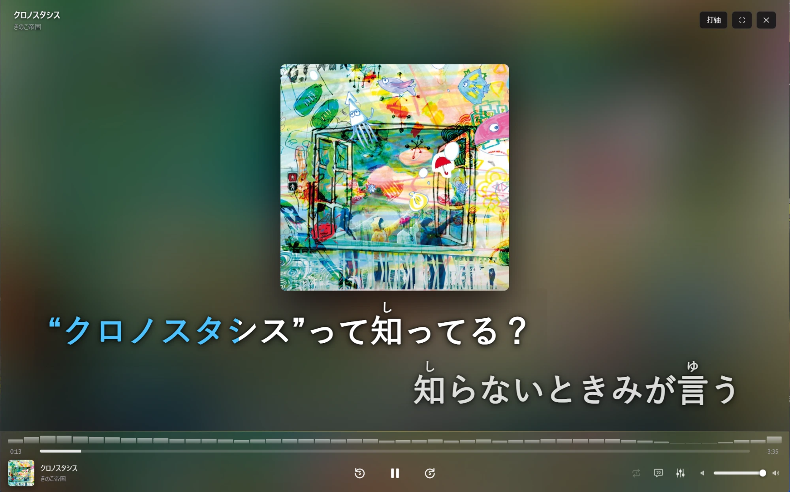
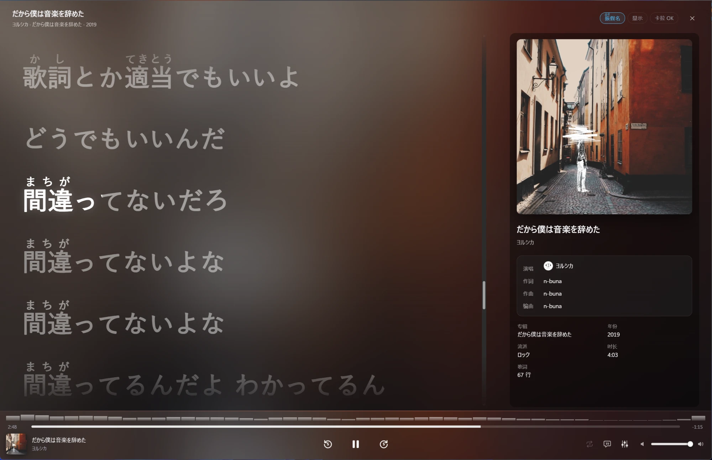
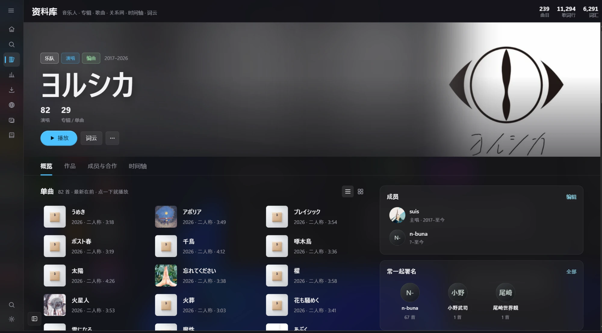

<div align="center">

# JPOP Corpus Tool

[](LICENSE)
[](https://github.com/Yisoragoto/jpop-corpus-tool/releases)
[](#从源码运行)

面向日语学习者的本地 J-pop 语料库。把自己拥有的歌曲和歌词导入后，跟着音频逐字读歌词、
点词查释义（Yomitan 那一套），在整个曲库里检索一个词、听它在每首歌里被唱出来的那一句，
做词频、搭配、子语料对比这些语料分析，再把刚听到的真实例句做成 Anki 卡片。

**简体中文** · [English](README.en.md)

<table>
<tr>
<td colspan="2"></td>
</tr>
<tr>
<td></td>
<td></td>
</tr>
<tr>
<td></td>
<td></td>
</tr>
</table>

</div>

> 本仓库只提供程序源码和构建工具，不包含商业歌曲、歌词、第三方词典、Anki 牌组或预生成语料数据库。

## 下载

去 [Releases](https://github.com/Yisoragoto/jpop-corpus-tool/releases) 下最新一版：

| 系统 | 文件 | 说明 |
|---|---|---|
| Windows 10/11 | `JPOP.Corpus.Tool_x.y.z_x64-setup.exe`（推荐）或 `.msi` | 需要 WebView2 运行时，系统一般已自带，安装程序也会按需引导 |
| macOS 14+（Apple Silicon） | `JPOP.Corpus.Tool_x.y.z_macOS_arm64.dmg` | 打开后把 `JPOP Corpus` 拖进「应用程序」 |

**macOS 第一次打开**：安装包没有经过 Apple 签名和公证，第一次双击会被拦下。去「系统设置 → 隐私与安全性」，
在下面找到这个应用，点「仍要打开」；或者在终端里执行一次：

```bash
xattr -dr com.apple.quarantine "/Applications/JPOP Corpus.app"
```

两个客户端共用同一个 Rust 核心、同一种库：Windows 上的库目录整个拷到 Mac 上就能打开，反过来也一样。

界面有**简体中文和英文**两种，第一次打开时选，之后在设置里随时切换。

**更新**：启动时查到新版会弹窗写明改了什么，由你选「立即更新」「稍后」或「跳过这个版本」。Windows 上安装包只从本仓库的
Releases 取，校验 SHA-256 之后直接覆盖安装（不用先卸载旧版），装完自动重新打开。默认跟正式版（stable）；
想抢先试用可以在设置里切到 debug 轨道，它跟着 main 的每次提交更新，Windows 和 macOS 都有。macOS 版会提示有新版，到 Releases 下载新的 `.dmg` 覆盖即可。

旧版（PyQt6）的 Python 代码留在仓库的 `legacy/` 下作参考，数据库 `corpus.db` 通用。

## 功能

### 首页

打开就能接着干：**继续听**停在上次那一行；今天听了多少、听完几首、制了几张卡；你听过的歌一共碰到过多少个词；
最近添加的歌。顶上的搜索框全库搜歌名、歌手、专辑、歌词和词。

### 资料库：音乐人、专辑、歌曲

- 按**音乐人、幕后、专辑、歌曲**四种方式找。乐队的成员收在乐队下面，前成员标出在队的年份；
  单飞的人另有自己的档案，个人作品和乐队时期的歌分开放。
- **音乐人档案**像音乐 App 的歌手页：大照片、角色和活动年份，一键播放全部、打开这个人的词云。
  - 概览：这个人的每一首歌，最新的在前，点一下就放（横条或大封面两种看法）；下面是专辑和 EP；
    右边是成员和「常一起署名」的人。
  - 作品（按专辑排的曲目表）、成员与合作、时间轴。
  - 歌手照片可以自己换，刮削不会覆盖，随时能恢复成刮削的那张。
- 成员关系来自刮削（MusicBrainz）、按署名推测后由你确认、或者手动添加；你改过、否掉的，刮削不会覆盖。
- 歌：面包屑（演唱者 › 专辑 › 歌名）、署名都能点；编辑、换歌词、逐行编辑歌词、来源与校验、删除收在「⋯」里。
- **关系网**照 Obsidian 的图谱：所有人和他们的合作连成一张网。颜色是角色，圆圈大小随参与的歌数变；
  实线是一起署过名，虚线是乐队和成员。能拖能缩放，按角色和「至少一起几首」过滤，双击打开档案。
- **时间轴**按发行日期排开每张专辑和单曲，带封面和曲目表；竖排、横排可选，乐队解散处接到单飞成员那一行。

<p align="center"></p>

### 播放与歌词

- **逐字歌词**：有逐字时间的歌唱到哪个字亮到哪个字，像普通音乐软件那样；只有行时间的歌整行高亮，
  不拿字数均摊去冒充逐字。
- **全屏歌词**：整张封面虚化铺底，右侧是封面和演唱、作词、作曲、编曲；点歌词里的词，右栏换成查词结果。
  振假名可以「只注汉字」或「整词注音」，字体、备用字体、字号、注音字号、行距、字距都能调，也能导入自己的字体文件。
- **卡拉 OK**：两行歌词 KTV 式上下交替，前奏显示歌名和制作人员，长间奏后入句前倒数。
- **打轴**：没有逐字时间的歌可以自己打——空格按下是这个字开始、松开是唱完，或者每字点一下；
  下方波形每个字一个色块，拖边缘改时间，±10 ms / ±100 ms 微调，能撤销重做，可以慢放着打。
  存成一版新的歌词，批量补歌词不会覆盖它。
- 点一行跳到那一句，可以对单句循环；一行从哪儿放到哪儿全软件只有一套规则，单句循环不会把间奏一起循环进去。
- 播放条照 Apple Music 的样子：前后跳 5 秒、倍速和变调合在一个面板里。倍速**变速不变调**（WSOLA），
  变调由内置的 Rubber Band 渲染一次并缓存。
- 整个软件按 F11 全屏；窄窗口和 27 寸以上的大屏都做了适配。

### 逐字歌词从哪来

导入时会读音频旁边的 `.lrc` 和音频里内嵌的歌词（增强 LRC 的逐字时间会保留）。还没有歌词、或者只有逐行歌词的：

- 刮削页「一键补全逐字歌词」处理全库；导入时默认勾上「导入后自动补歌词，优先逐字」。
- 单首可以「搜索逐字歌词」，看每个候选的来源、格式、真实逐字行数和正文预览，再决定采不采用。
- 来源：QQ 音乐（QRC）、酷狗（KRC）、AMLL 社区逐词歌词库（TTML）、LRCLIB、网易云。来源可以逐个开关。
  QQ 音乐和酷狗没有公开的歌词 API，走的是它们客户端用的非公开接口，随时可能失效；只在本机读取、供个人学习，不缓存或分发正文。
- **挑不准就不要**：歌名、歌手、时长都要对得上，正文和现有歌词至少 97% 一致才自动采用；拿不准的列进待复核。
  你手动导入、编辑、打轴过的歌词不会被批量覆盖。
- 也可以自己导入歌词文件：`.lrc` / `.txt` / `.yrc` / `.qrc` / `.krc` / `.ttml`，UTF-8、Shift-JIS、GBK 都认。

细节见 [docs/word-lyrics.md](docs/word-lyrics.md) 和 [docs/karaoke.md](docs/karaoke.md)。

### 查词（Yomitan 词典）

[Yomitan](https://github.com/yomidevs/yomitan) 是浏览器上的日语弹出式查词扩展（Yomichan 的继任者），
它定义了一套词典打包格式：一个 zip 里装着词条、按读音区分的词频、音高（アクセント）和结构化释义。
**本工具查词这一块是按 Yomitan 的做法移植到 Rust 的**，所以可以直接用它那一套词典：

- 在「词典」页导入 Yomitan 格式的 zip，想装几本装几本，按种类（释义 / 词频 / 音高）分开，拖着排顺序——查词结果按这个顺序出。
- 活用形、片假名、罗马字都能查；从点的词一直到行尾做最长匹配，所以
  「打ち込んでいませんでした」点第一个词就能还原到「打ち込む」。
- 释义按词典原样式显示（层级、例句、图片），音高和词频按读音分别显示。
- 在歌词里点词，上面先告诉你这个词在你的语料里出现了几次、在几首歌、几位歌手、哪些年份；
  下面「词典」「例句」两页：一页是释义，一页是这个词在整个语料里出现过的句子，点 ▶ 就听那一句。

**词典本身要自己准备，仓库里不含任何词典。** 常用的几本（JMdict / 三省堂 / 明鏡 / JPDB 词频 / アクセント辞典 等）
可以在 [MarvNC/yomitan-dictionaries](https://github.com/MarvNC/yomitan-dictionaries) 找到下载地址。
各词典的版权和再分发条件由各自作者决定，自行确认。


### 检索：从一个词到它被唱出来的那一句

- KWIC 语境检索：关键词居中对齐，可以按写法或辞书形（駆ける / 駆けた / 駆けろ 归到一起）匹配，
  按歌手、年份、词性、是否跨行、是否仅日文筛选，也可以限定在一个子语料里；结果可导出 CSV。
- 多词表达：`て+しまう` 这种连着出现的几个词当一个整体查；「附近有某词」只留下前后几个词以内出现它的行。
- 同一首歌里一模一样的行（副歌）默认合成一条，标出重复了几次。
- **检索结果直接连着播放器**：每条 ▶ 原地试听那一句（到行尾自动停），⟲ 连前后各一行一起听，
  单击跳到那首歌的那一行接着放，歌词跟着高亮。
- 搭配面板：关键词左右 3 词内的搭配词，点一个搭配词把 KWIC 收窄到「附近有它」的行。


### 词云

- 范围可以是整个库、一位音乐人或一个子语料，也可以只看某几年。
- 同一个词的不同写法合成一个（想い出 → 思い出、ひとり → 一人；读音也对得上才合）。
- 助词、助动词和「つ」「ら」「まま」这类单假名、形式名词默认去掉；不想看的词点一下「不在词云里显示」，随时恢复。
- 可以按词性上色。
- 点词列出出现它的歌，**这个词在句首的排在前面**；点歌**从这个词本身开始放**——有逐字时间就准到字，
  没有的话可以听着按一下校准，记下来下次就准。
- 同一栏也在**分析**页的表格和**词典**页旁边：在那里点任何一个词，列出出处、从这个词开始放，人不用离开当前页面。
  **检索**页单击一条也从命中的词开始放、留在检索页（双击才去资料库看整首）。放歌时每一页底部都显示正在唱的那句，
  刚看的那个词标亮；从那里进全屏歌词，退出后回到原来的页面。
- 可以全屏、存 PNG。

### 分析：副歌不撑大数字，结果说得清从哪来

J-pop 的副歌会反复唱：真实语料里重复行占了约 23% 的行、20% 的词次。直接数的话，高频词表里有不少是副歌堆出来的。
所以分析页的每种统计都可以选两种口径——**全部词次**，或者**同一首歌里重复的行只算一次**。

- **词频**：词元 × 词性，带 JLPT 等级；两种口径的数都给，外加「来自重复行的比例」和离散度（DP、ARF）。
- **KWIC 排序与分布图**：按关键词左右第几个词排序；分布图里每首歌一条，看一个词散在全曲还是挤在副歌。
- **CQL 检索**：按词的属性组合条件找词串，比如 `[lemma="君"] [pos="ADP"]`、`[pos="VERB" & cform="命令形.*"]`、
  `[lemma="て"] []{0,2} [lemma="しまう"]`；边输边检查语法。
- **按年份 / 歌手分解**：一次检索在每一年、每位演唱者的歌里每万词出现几次，小样本的组会标出来。
- **搭配网络**：关键词和它最强的 20 个搭配词，以及搭配词彼此之间的共现。
- **搭配**：logDice、MI、MI3、t 值、z 值、对数似然、双向 ΔP。
- **N-gram**：连续 2~5 个词的固定组合，不跨行、不跨标点，可以要求至少出现在几首歌里。
- **活用与写法**：活用形分布（点例词带着活用形去检索），同一个词的不同写法（君 / きみ / キミ）；检索可以按读音、正规化表记匹配。
- **副歌效应**：同一批歌两种口径各算一遍，看哪些词的排名是被副歌推上去的。
- **子语料对比**：圈两批歌（一位歌手和其余所有歌，或者 2010 年代和 2020 年代），用带符号的对数似然和 Log Ratio
  找出哪边明显多用、少用哪些词；按 p 值筛选，可做 Bonferroni 校正。
- **词汇丰富度与文字**：整体、每位演唱者、每首歌的 MATTR、MTLD、Yule's K，以及汉字、平假名、片假名、拉丁字母的比例。
- **歌曲画像**：一首歌有多少行是重复的、相对其余歌的特征词。
- 词频统计、按年份的时间线、TTR / 标准化 TTR、语料报告 TXT 导出。

**子语料**：按演唱者、年份、专辑、流派、歌词语言、指定歌曲、歌词完整度下限切一块出来，条件之间是「且」、
同一条件里多选是「或」。条件可以起名存下，KWIC、词云、例句、词频、搭配、对比都能直接选它。

**每个结果都带出处**：范围、计数口径、规则版本，以及当时库的指纹。指纹和参数都一样，结果就一样。

**可复现的分析**：存档时连同筛选条件、纳入的每首歌和它的歌词版本、分词器、统计口径、程序和库结构的版本一起存下。
之后在现在的库上原样重跑，逐项对比，并说明结果为什么变了——是库变了，还是统计规则变了。

用到的统计方法和出处见文末的[方法：基于语料库语言学](#方法基于语料库语言学)。


### 语料质量与来源追踪

- **每份歌词都留一版**：来源（文件 / 内嵌 / 在线 / 手动 / 打轴）、导入时间、原文一字不改、内容指纹。
  换歌词是加一版，旧版能看原文、能恢复。
- **自动校验**：漏行、截断、重复贴行、时间倒退、超出歌长、长空档、乱码、残留的时间标记和署名、语言不是日文；
  给出完整度估计。
- **逐行编辑歌词**：改字、加删行、挪时间戳，存成新的一版，重新分词，并按原文把你的分词校正套回去。
- **修订历史**：换歌词、打轴、分词校正和撤销、重新分词、改曲目信息、删歌都留记录。
- **字段来源**：每个字段是从标签、文件名、目录、刮削（哪个来源、匹配分多少）还是你手改来的；手改的不会被自动流程覆盖。
- **内容身份**：ISRC、MusicBrainz ID、厂牌，以及不随文件改名变化的音频指纹。

设计说明见 [docs/provenance.md](docs/provenance.md) 和 [docs/content-identity.md](docs/content-identity.md)。

### Anki 制卡

[Anki](https://apps.ankiweb.net/) 是开源的间隔重复记忆软件，
[AnkiConnect](https://ankiweb.net/shared/info/2055492159) 是它的插件，开一个本机接口让别的程序往里加卡片——
本工具就是通过它制卡的，**只连本机，不上传任何东西**。

- 查词结果上点「＋ 制卡」，词、释义、词频、音高和真实例句一起进 Anki。
- 自带「Lyrics」笔记类型：照 [Lapis](https://github.com/donkuri/lapis) 改的，背面右侧是歌曲封面和歌名、歌手、专辑。
  Anki 里没有这个类型时第一次制卡会自动建。
- 例句是你点的那一行，这首歌里其他含这个词的句子接在后面，**每句都从歌里切一段对应的音频**。
- 可选按歌手放进「牌组::歌手」子牌组；能读 Anki 的学习状态，排除已经学过的词。
- Anki 页可以批量选词、预览、导出；挖词报告（HTML）按 JLPT 分级列出语料里还没做成卡片的词。


### 导入、刮削与曲库维护

- 导入：**选一个目录，或者直接选几首歌**；扫描只读取，复核计划之后才写库；**不覆盖本地文件里的原始 metadata**。
  计划里标出每个文件是新歌、已在库中、可能重复还是导不了。
- 往库里的歌所在的文件夹再放新音频，下次启动会提示「检测到 N 首新歌」，点一下就导进来。
- 刮削页是一张「库的完整度」清单：识别、曲目封面、专辑封面、专辑信息（发行类型、曲目数）、歌手照片、歌词、
  时长各一行，缺几个、点一下补那几个；「一键补全逐字歌词」也在这一页。
  - 曲目用 iTunes → MusicBrainz 识别（可选 Apple Music 目录），封面取 Cover Art Archive，歌手照片取 Deezer；
    置信度不够的停在「需确认」等人工看一眼。
  - 刮削歌手时顺带取乐队成员、解散时间和完整发行日期。
- 旧库在别的地方：「设置 → 曲库维护 → 从别的语料库目录迁移数据」先预览，再**合并**进当前库。
- 设置里可以「导出诊断信息」：版本、库在哪、库里有多少东西、词典和音频状态、最近的错误，一次打包，报问题时附上。

### 原生 macOS 客户端

`macos/` 是原生 SwiftUI 客户端（播放用 AVFoundation，实时变速变调），业务逻辑**不另写一套**：
检索、分析、导入、分词、查词、制卡、刮削、歌词时间轴、库结构和迁移都调同一个 Rust 核心
（经 `jp-ffi`：一个入口、JSON 进出，方法名和 Windows 版的命令一致）。

上面列的功能 Mac 上都有：首页、资料库（关系网、时间轴、词云）、全屏歌词、卡拉 OK 与打轴、逐字歌词获取、
检索与试听、分析与存档、词典、Anki 制卡与 Anki 页、刮削、导入、检查更新。逐项状态和测试覆盖见
[macOS 能力矩阵](docs/macos-status.md)。

- 打开 Windows 拷来的库：库里记的是 `E:\...` 这种路径时，按文件名到你指定的音频文件夹里找。
- 也可以在 `~/Library/Application Support/JPOP Corpus Tool` 新建一个库。

### 命令行

`jp` 是同一份库的批处理入口：查库信息、扫描、导入、补分词、刮削、导出 Anki TSV、重算音频指纹。
要从源码构建（`cargo run -p jp-cli -- <命令>`），见 [docs/cli.md](docs/cli.md)。

## 第一次使用

1. 进「导入」，选一个装着自己合法拥有的音频的目录，或者直接挑几首；同目录下同名的 `.lrc` 会自动匹配。
2. 看过扫描计划再决定导不导。
3. 没有歌词或只有逐行歌词的，去「刮削」页补，或者在资料库里单首处理。
4. 想要封面、歌手照片和乐队成员，也在「刮削」页把缺的补上。
5. 想查词，去「词典」页导入 Yomitan 格式的 zip。
6. 要制卡就启动 Anki 并装上 AnkiConnect（见下）。

### 数据目录

`corpus.db`、`raw/audio`、`raw/lyrics_lrc`、`raw/covers`、`dictionaries.db` 的查找顺序：

1. 环境变量 `JPOP_CORPUS_HOME` 指向的目录；
2. 设置页里选过的目录（记在 `%LOCALAPPDATA%\JPOP Corpus Tool\settings.json`）；
3. 从可执行文件往上找，第一个**建好表**的库；
4. 当前工作目录；
5. 都没有就用 `%LOCALAPPDATA%\JPOP Corpus Tool`，**并在那里新建一个空库**。

macOS 上默认目录是 `~/Library/Application Support/JPOP Corpus Tool`。数据目录不放在安装目录下，
卸载不会把你的歌和语料一起删掉。已经有库的话，在设置里「切换目录…」选它，重启就接上了。

库的结构有版本号，打开旧库时自动补齐（只加表加列，不动已有数据）；比程序新的库会被拒绝打开，不会被改坏。

> **振假名、在歌词里点词、导入时分词，都需要 Sudachi 词典。** 安装包里不带它（解开 207 MB）。
> 缺词典时会弹出一条横幅，设置里也有「下载」按钮——从本仓库 `sudachi-dict-core` 那个发布下一个 43 MB 的 `.xz`
> （断了能接着下），按固定的 SHA-256 校验，解压到语料库目录的 `sudachi/` 里。也可以从手头已有的目录复制。
> 装好之后，之前没分词就导进来的歌会顺手补上分词。
>
> 没有它时播放、「词典」页、检索、制卡照常；只是新导进来的歌没有分词，检索和分析里看不到它们。

### 配置 Anki

1. 安装并启动 [Anki](https://apps.ankiweb.net/)。
2. 安装 [AnkiConnect（插件代码 2055492159）](https://ankiweb.net/shared/info/2055492159)。
3. 在设置的「制卡」里选好牌组和笔记类型（默认用自带的「Lyrics」，没有就第一次制卡时自动建）。

AnkiConnect 默认只监听本机地址（`http://127.0.0.1:8765`），本工具不会把你的语料或 Anki 数据传到任何地方。
制卡**只追加不覆盖**：同一个词再制一次会跳过，不会动你已有的卡片。

## 从源码运行

### 需要

- [Node.js](https://nodejs.org/) 20+
- [Rust](https://rustup.rs/) stable，以及 MSVC 的 C++ 生成工具（SQLite、LAME、Rubber Band 都是从源码编的）
- Windows 10/11 和 WebView2 运行时
- macOS 客户端另需 macOS 14+ 和 Xcode 15.3+（Swift 5.10）

### Windows 客户端

```powershell
git clone https://github.com/Yisoragoto/jpop-corpus-tool.git
cd jpop-corpus-tool\app
npm install
npm run app:dev      # 开发模式
npm run app:build    # 打包，产物在 rust/target/release/bundle/
```

### macOS 客户端

```bash
./macos/scripts/build-rust.sh      # 构建 Rust 核心的静态库 libjp_ffi.a（加 universal 出通用二进制）
cd macos && swift run JPCorpus      # 直接跑；./scripts/bundle.sh 打成 .app
swift test                          # 经真的静态库调 Rust，检查跨语言的数据形状和导入、检索的整条链路
```

### 只跑检查

```powershell
cd app
npm run typecheck
npm test
cd ..\rust
cargo test --workspace
cargo clippy --workspace --all-targets
```

仓库中的 `examples/` 提供数据格式示例，不含真实歌曲或歌词。

CI 有三条：`check.yml` 跑前端类型检查和测试、Rust 测试和 clippy；`macos.yml` 在 macOS 上构建 Rust 静态库、
`swift build`、`swift test`，并把 .app 真的跑起来截图；`release.yml` 推 main 时出 debug 预发布，
手动选 stable 时出正式版（Windows 安装包 + macOS `.dmg`）。

### 目录说明

```text
app/           Windows 客户端前端（React 19 + TypeScript strict + Vite）
macos/         原生 macOS 客户端（SwiftUI + AVFoundation），业务逻辑全部来自 Rust 核心
rust/          Rust workspace
  jp-app/        Tauri 壳：command、状态、路径授权
  jp-ffi/        给 macOS 客户端的 C ABI（JSON 进出）
  jp-cli/        命令行 jp
  jp-corpus/     数据层，SQL 全在这里；检索、分析、子语料、行区间、词级时间、来源追踪、迁移
  jp-library/    两端共用的资料库管理：事务、文件维护、迁移
  jp-lyrics/     歌词编辑、版本、时间轴和在线获取
  jp-tokenizer/  分词与 UPOS 映射（Sudachi）
  jp-setup/      分词词典的定位、下载、校验和断点续传
  jp-audio/      播放引擎：WSOLA 变速、变调、频谱、单句循环、波形
  jp-dict/       Yomitan 式查词与词典导入
  jp-anki/       Anki 制卡与挖词报告
  jp-scraper/    曲目识别、封面、歌手照片、乐队成员、在线歌词
  jp-scrape/     把刮削结果写进库（两端共用）
  jp-import/     扫描、计划、写库
  jp-normalize/  曲名 / 歌手名归一化
  jp-fonts/      歌词字体：本机字体与导入的字体文件
  jp-update/     检查更新、下载校验
  jp-diagnostics/ 导出诊断信息
docs/          每个子系统的设计与对账记录
legacy/        0.1.x 的 PyQt 版，保留作参考
scripts/       发版守卫和自检脚本
assets/fonts/  随软件分发的 OFL 字体及许可证
examples/      不含版权内容的数据格式示例
```

`docs/` 里记的是每个子系统**怎么做的、为什么这么做、和旧版逐项对过哪些数字**：

| 文档 | 内容 |
|---|---|
| [clients.md](docs/clients.md) | 一个 Rust 核心、两个客户端；数据怎么关联到音频；分析的计数口径 |
| [macos-status.md](docs/macos-status.md) · [macos-player.md](docs/macos-player.md) | macOS 能力矩阵与验证；macOS 播放器 |
| [word-lyrics.md](docs/word-lyrics.md) · [karaoke.md](docs/karaoke.md) | 逐字歌词的来源与验证；卡拉 OK 和打轴 |
| [provenance.md](docs/provenance.md) · [content-identity.md](docs/content-identity.md) | 歌词版本、校验、修订历史、字段来源、可复现的分析；ISRC、MBID 和音频指纹 |
| [import.md](docs/import.md) | 扫描、计划、写库，歌词匹配 |
| [tokenizer.md](docs/tokenizer.md) · [token-corrections.md](docs/token-corrections.md) | 分词、词性映射、分词校正 |
| [dictionary.md](docs/dictionary.md) | Yomitan 查词的移植与对账 |
| [anki.md](docs/anki.md) | 制卡、Lyrics 笔记类型、挖词报告 |
| [scraper.md](docs/scraper.md) · [scraper-rust.md](docs/scraper-rust.md) | 刮削的来源、匹配和置信度 |
| [updates.md](docs/updates.md) | stable / debug 发布轨道与更新校验 |
| [cli.md](docs/cli.md) | 命令行 |
| [testing.md](docs/testing.md) · [BUGS.md](docs/BUGS.md) | 测试与冒烟；Bug 复现、根因与回归测试 |
| [rust-core.md](docs/rust-core.md) · [tauri-shell.md](docs/tauri-shell.md) | Rust 各 crate 的分工、Tauri 壳 |

## 方法：基于语料库语言学

这个工具是一个小型的专门语料库：语料是你自己的歌，单位是带时间戳的歌词行，分析方法取自语料库语言学的常规做法。
下面写的是程序里实际怎么算的。

**语料与标注。** 每首歌的歌词按行入库，用 Sudachi 分词（默认 C 模式），UniDic 词性映射到
[Universal Dependencies 的 UPOS](https://universaldependencies.org/u/pos/)，词元取 Sudachi 的辞书形。
每个词另存日语形态信息：细分词性、活用型、活用形、读音和正规化表记（キミ → 君、逢う → 会う）；
老库升级后在后台按原文对齐补上，已有的切分和词性不动。
你改过的分词作为校正单独存，重新分词后按原文套回。

**CQL 检索。** 语法取 Sketch Engine / CQP 的 Corpus Query Language 的一个子集：方括号里写一个词的条件
（`word` `lemma` `pos` `tag` `ctype` `cform` `reading` `norm`，值是整个匹配的正则，可用 `&` `|` `!`），
`[]` 是任意一个词，`?` `*` `+` `{m,n}` 是重复次数。词串不跨行，标点也算词；每个起点取最长的匹配，匹配之间不重叠。

**频率分解与搭配网络。** 检索结果可以按年份或演唱者分组，折成每万词（命中和分母都按全部词次，分母不含标点），
并给出相对整体的倍数；词次不到 1,000 的组标为小样本。搭配网络以节点词为中心，取搭配表的前 20 个词，
再数它们彼此在同一窗口里的共现，按 logDice 给每个词留最强的三条边。

**活用与写法。** 有活用的词按活用形统计（命令形、意志推量形……），检索可以按活用形筛选。
同一个词的不同写法（君 / きみ / キミ）按正规化表记归组；全是假名的写法按读音并到同词性的汉字写法，
可能动词（行ける）和原动词（行く）按活用型分开。检索也能按读音或正规化表记匹配。

**检索。** KWIC（Key Word in Context）语境行是语料库检索的基本形式（Sinclair 1991）：关键词居中，左右是上下文。
可以按写法或词元匹配，支持多词序列和「附近有某词」的共现过滤；能按关键词左右第 *n* 个词排序，
也能画成分布图（每首歌一条，命中的行按位置画刻度）。

**计数口径。** 歌词和书面语料最大的不同是重复：副歌会原样唱好几遍。这里把「同一首歌里文字完全相同的行」
当作一个重复组，所有统计都可以选全部词次或每组只算一次，并给出两者之差（来自重复行的比例）。
这相当于在歌这一层做的去重，用来检验一个词的高频是来自很多歌，还是来自少数几首歌的副歌。

**频率与离散度。** 词元 × 词性的绝对频率与每万词频率。只看频率分不清「很多歌都用」和「少数几首反复用」，
所以以一首歌为一个部分、按歌长加权给离散度：

| 指标 | 定义 | 出处 |
|---|---|---|
| DP | ½ Σ \|vᵢ/f − sᵢ\|，0 = 均匀，1 = 集中；DPnorm 再除以 1 − min sᵢ | Gries 2008；Lijffijt & Gries 2012 |
| Juilland D | 1 − CV / √(n − 1)，CV 是各歌相对频率的变异系数 | Juilland & Chang-Rodríguez 1964 |
| ARF | 词流首尾相接成环，相邻两次出现的距离超过 N/f 的部分不算 | Savický & Hlaváčová 2002 |

**N-gram。** 连续 *n* 个词的组合（Biber 等的 lexical bundles），不跨行、不跨标点，可以要求最少出现曲数，
排除只在一首歌的副歌里重复的组合。

**词汇丰富度。** TTR（词种 ÷ 词次）和标准化 TTR（按固定长度分段取平均，Scott 的 WordSmith 做法）会随文本变长而下降，
不同规模的文本不能直接比，所以另给三个受长度影响小的指标：MATTR（窗口 50，Covington & McFall 2010）、
MTLD（阈值 0.72，正反两遍取平均，McCarthy & Jarvis 2010）、Yule's K。文字种按字符数分汉字、平假名、片假名、拉丁字母和其他。

**搭配。** 在关键词左右各 *n* 个词的窗口里数共现，期望频率按实际窗口位置数算：

| 指标 | 公式 | 出处 |
|---|---|---|
| MI | log₂(O / E) | Church & Hanks 1990 |
| t 值 | (O − E) / √O | Church et al. 1991 |
| logDice | 14 + log₂(2·O / (f₁ + f₂)) | Rychlý 2008 |
| 对数似然 G² | 2×2 列联表 | Dunning 1993 |
| MI3 | log₂(O³ / E) | Daille 1994 |
| z 值 | (O − E) / √E | Berry-Rogghe 1973 |
| ΔP | P(搭配词 \| 节点窗口) − P(搭配词 \| 窗口外)，两个方向都给 | Gries 2013 |

MI 偏向低频词，t 值偏向高频词，logDice 不受语料大小影响，适合在不同子语料之间比较；ΔP 有方向，
能分出「A 引出 B」和「B 引出 A」。

**关键词与子语料对比。** 两批歌之间逐词比较：用对数似然 G²（Rayson & Garside 2000 的两格算法）判断差异是否显著，
按方向加上正负号；用 Log Ratio（Hardie 2014，两边频率比的 log₂，零频按 0.5 平滑）表示差异有多大。
显著性和效应量分开看，避免大语料里一点小差异也被当成「关键词」。p 值按自由度 1 的卡方分布算，
可设门槛并做 Bonferroni 校正（一次检验几千个词）；另给 BIC（Wilson 2013）和 %DIFF（Gabrielatos & Marchi 2012）。

**可复现。** 语料会变（加歌、换歌词、改分词），所以每次分析都记下库的指纹、规则版本和参数；存档的分析可以原样重跑，
逐项对比结果，并说明差异来自数据还是来自规则。

参考文献：

- Berry-Rogghe, G. L. M. (1973). The computation of collocations and their relevance in lexical studies. In A. J. Aitken et al. (Eds.), *The Computer and Literary Studies* (pp. 103–112). Edinburgh University Press.
- Biber, D., Johansson, S., Leech, G., Conrad, S., & Finegan, E. (1999). *Longman Grammar of Spoken and Written English*. Longman.
- Church, K. W., & Hanks, P. (1990). Word association norms, mutual information, and lexicography. *Computational Linguistics*, 16(1), 22–29.
- Church, K. W., Gale, W., Hanks, P., & Hindle, D. (1991). Using statistics in lexical analysis. In U. Zernik (Ed.), *Lexical Acquisition* (pp. 115–164). Erlbaum.
- Covington, M. A., & McFall, J. D. (2010). Cutting the Gordian knot: The moving-average type–token ratio (MATTR). *Journal of Quantitative Linguistics*, 17(2), 94–100.
- Daille, B. (1994). *Approche mixte pour l'extraction automatique de terminologie*. PhD thesis, Université Paris 7.
- Dunning, T. (1993). Accurate methods for the statistics of surprise and coincidence. *Computational Linguistics*, 19(1), 61–74.
- Gabrielatos, C., & Marchi, A. (2012). Keyness: Appropriate metrics and practical issues. CADS International Conference, University of Bologna.
- Gries, S. Th. (2008). Dispersions and adjusted frequencies in corpora. *International Journal of Corpus Linguistics*, 13(4), 403–437.
- Gries, S. Th. (2013). 50-something years of work on collocations. *International Journal of Corpus Linguistics*, 18(1), 137–165.
- Hardie, A. (2014). Log Ratio: An informal introduction. ESRC Centre for Corpus Approaches to Social Science (CASS).
- Juilland, A., & Chang-Rodríguez, E. (1964). *Frequency Dictionary of Spanish Words*. Mouton.
- Lijffijt, J., & Gries, S. Th. (2012). Correction to Stefan Th. Gries' "Dispersions and adjusted frequencies in corpora". *International Journal of Corpus Linguistics*, 17(1), 147–149.
- McCarthy, P. M., & Jarvis, S. (2010). MTLD, vocd-D, and HD-D: A validation study of sophisticated approaches to lexical diversity assessment. *Behavior Research Methods*, 42(2), 381–392.
- Rayson, P., & Garside, R. (2000). Comparing corpora using frequency profiling. In *Proceedings of the Workshop on Comparing Corpora* (pp. 1–6).
- Rychlý, P. (2008). A lexicographer-friendly association score. In *Proceedings of RASLAN 2008* (pp. 6–9).
- Savický, P., & Hlaváčová, J. (2002). Measures of word commonness. *Journal of Quantitative Linguistics*, 9(3), 215–231.
- Scott, M. WordSmith Tools 帮助文档：Standardised type/token ratio.
- Sinclair, J. (1991). *Corpus, Concordance, Collocation*. Oxford University Press.
- Wilson, A. (2013). Embracing Bayes factors for key item analysis in corpus linguistics. In M. Bieswanger & A. Koll-Stobbe (Eds.), *New Approaches to the Study of Linguistic Variability* (pp. 3–11). Peter Lang.

## 依赖

| 名称 | 许可证 |
|---|---|
| [Tauri 2](https://tauri.app/) | Apache-2.0 / MIT |
| [React 19](https://react.dev/) | MIT |
| [rodio](https://github.com/RustAudio/rodio) · [rodio-wsola](https://crates.io/crates/rodio-wsola) | MIT / Apache-2.0 · Apache-2.0 |
| [Symphonia](https://github.com/pdeljanov/Symphonia)（解码） | MPL-2.0 |
| [sudachi.rs](https://github.com/WorksApplications/sudachi.rs) | Apache-2.0 |
| [rusqlite](https://github.com/rusqlite/rusqlite) · SQLite | MIT · Public Domain |
| [lofty](https://github.com/Serial-ATA/lofty-rs)（读音频标签） | MIT / Apache-2.0 |
| [ureq](https://github.com/algesten/ureq) | MIT / Apache-2.0 |
| [serde](https://serde.rs/) | MIT / Apache-2.0 |

## 致谢与出处

| 名称 | 用在哪 | 许可证 |
|---|---|---|
| [Yomitan](https://github.com/yomidevs/yomitan) | 查词、活用还原、结构化释义、音高显示 | GPL-3.0-or-later |
| [Lapis](https://github.com/donkuri/lapis) | 自带「Lyrics」笔记类型的底本 | GPL-3.0 |
| [hoshidicts](https://github.com/Manhhao/hoshidicts) | 词典存储设计（未复制代码） | GPL-3.0-or-later |
| [LDDC](https://github.com/chenmozhijin/LDDC) · [AMLL TTML DB](https://github.com/amll-dev/amll-ttml-db) | 逐字歌词格式与来源的参考 | GPL-3.0 · CC0-1.0 |
| [Klee One](https://fonts.google.com/specimen/Klee+One) · [霞鹜文楷](https://github.com/lxgw/LxgwWenKai) | 随软件分发的字体 | SIL OFL 1.1 |
| [Rubber Band Library](https://breakfastquay.com/rubberband/) | 变调。源码在 [`third_party/rubberband/`](third_party/rubberband/)，编进程序里 | GPL-2.0-or-later |
| [LAME](https://lame.sourceforge.io/) | Anki 卡片上音频片段的 MP3 编码，编进程序里 | LGPL-2.0-or-later |

逐文件的出处写在各文件头部，完整说明见 [THIRD_PARTY_NOTICES.md](THIRD_PARTY_NOTICES.md)。

## 版权边界

请勿提交或再分发以下内容：

- 商业歌曲音频或未经授权的歌词、LRC 文件；
- 包含真实歌词的 `corpus.db`、处理后语料或 Anki 牌组；
- 无再分发许可的第三方 Yomitan 词典；
- 本机设置、缓存、备份和用户路径。

本工具用于处理用户自行提供且有权使用的材料。使用者应自行确认所在地区适用的版权和合理使用规则。

## 许可证

程序源码使用 [GNU General Public License v3.0 或更高版本](LICENSE)（GPL-3.0-or-later）。
Copyright (C) 2026 Yisoragoto and JPOP Corpus contributors。
